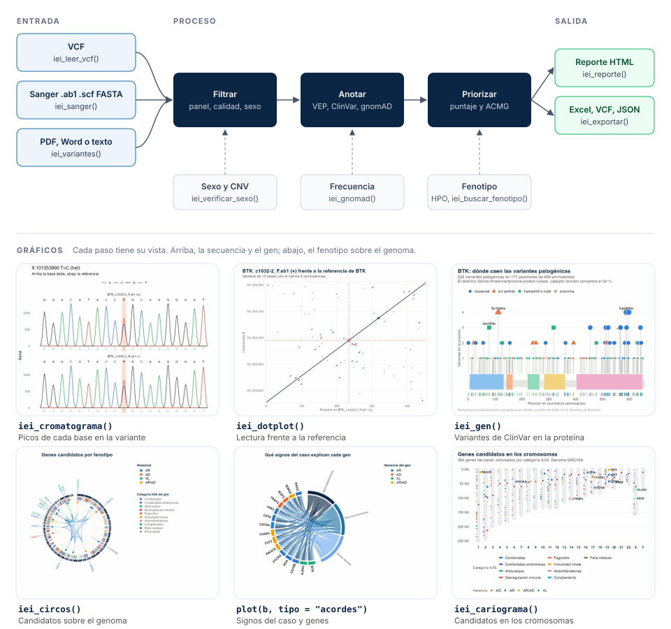

# ieiprio 

<!-- badges: start -->
[](https://github.com/Gentlenmoron/ieiprio/actions/workflows/R-CMD-check.yaml)
[](https://github.com/Gentlenmoron/ieiprio/actions/workflows/test-coverage.yaml)
[](https://gentlenmoron.github.io/ieiprio/)
[](LICENSE.md)
<!-- badges: end -->

`ieiprio` encuentra, anota y prioriza variantes en genes de errores innatos de
la inmunidad a partir de secuencias Sanger, FASTA, VCF o el texto de un
informe. Trabaja solo con lo que sale de la secuencia y de bases de datos
curadas, para que el mismo archivo dé siempre el mismo resultado.

## Características principales

- Lee variantes desde VCF, cromatogramas Sanger (`.ab1`, `.scf`), FASTA, una
  secuencia escrita o el texto de un informe en PDF o Word.
- Llama variantes Sanger con detección de heterocigotos por picos dobles y las
  muestra en el cromatograma, base por base.
- Anota con Ensembl VEP, ClinVar y gnomAD, con caché local y modo sin conexión.
- Prioriza con un puntaje explicado en texto y criterios ACMG por puntos.
- Compara el fenotipo del caso (términos HPO) con cada enfermedad del panel
  IUIS de PanelApp.
- Entrega un reporte HTML por paciente y exporta a Excel, VCF, BED o
  Phenopacket.

## Instalación

```r
install.packages("pak")
pak::pak("Gentlenmoron/ieiprio")
```

Para tener también las guías dentro de R, instala con `remotes` y construye
las viñetas.

```r
install.packages("remotes")
remotes::install_github("Gentlenmoron/ieiprio", build_vignettes = TRUE)
browseVignettes("ieiprio")
```

## Entradas

| Entrada | Formato | Función |
| --- | --- | --- |
| VCF | `.vcf`, `.vcf.gz`, GRCh37 o GRCh38 | `iei_leer_vcf()` |
| Cromatograma Sanger | `.ab1`, `.scf` | `iei_sanger()` |
| FASTA | `.fa`, `.fasta` | `iei_sanger()` |
| Secuencia escrita | Texto con las bases | `iei_sanger()` |
| Informe | PDF, Word o texto | `iei_variantes()` |

## Flujo de trabajo

<div class="flujo">

</div>

*De la secuencia al reporte. En azul las entradas, en oscuro el proceso y en
verde las salidas. Debajo, el gráfico que acompaña cada paso. Los ejemplos
completos que los generan están en la guía [Casos de ejemplo](https://gentlenmoron.github.io/ieiprio/articles/casos.html).*

## Funciones disponibles

| Función | Qué hace |
| --- | --- |
| `iei_analizar()` | Corre el flujo completo de un VCF y deja un reporte por muestra |
| `iei_leer_vcf()`, `iei_verificar_sexo()` | Leer un VCF y comparar el sexo declarado con el del cromosoma X |
| `iei_filtrar()`, `iei_bitacora()` | Filtrar por panel y calidad, con el registro de cada paso |
| `iei_cnv()` | CNV que trae el VCF cruzadas con el panel |
| `iei_sanger()` | Llamar variantes desde `.ab1`, `.scf`, FASTA o una secuencia escrita |
| `iei_cromatograma()` | Trazas alrededor de una variante, con la base leída y la de referencia |
| `iei_dotplot()` | Dot plot de una secuencia frente a otra o frente a la referencia |
| `iei_consenso()` | Unir lecturas directa y reversa en una secuencia |
| `iei_leer_ab1()`, `iei_leer_scf()` | Leer cromatogramas |
| `iei_variantes()`, `iei_variante()` | Variantes desde PDF, Word, texto o HGVS |
| `iei_anotar()`, `iei_gnomad()` | Anotar con Ensembl VEP, ClinVar y gnomAD |
| `iei_filtrar_frecuencia()` | Descartar variantes comunes según la herencia del gen |
| `iei_priorizar()`, `iei_pesos()` | Puntaje explicado y criterios ACMG por puntos |
| `iei_reporte()` | Reporte HTML de un paciente |
| `iei_exportar()`, `iei_phenopacket()`, `iei_granges()` | Excel, VCF, BED, Phenopacket o `GRanges` |
| `iei_buscar_fenotipo()`, `iei_buscar_hpo()` | Genes del panel por parecido con el fenotipo |
| `iei_validar_fenotipo()` | Medir la búsqueda por fenotipo con casos simulados |
| `iei_gen()` | Ficha de un gen con sus variantes de ClinVar |
| `iei_circos()`, `iei_cariograma()` | Panel, candidatos o variantes sobre el genoma |
| `iei_panel()`, `iei_buscar_gen()`, `iei_fuentes()` | Panel de genes y versiones de los datos |
| `iei_app()` | Aplicación Shiny |

## Documentación

El sitio del paquete, <https://gentlenmoron.github.io/ieiprio/>, reúne la
referencia de cada función y cuatro guías.

| Guía | Contenido |
| --- | --- |
| [Primeros pasos](https://gentlenmoron.github.io/ieiprio/articles/ieiprio.html) | Instalación, fundamentos y cada tipo de entrada |
| [Interpretación de resultados](https://gentlenmoron.github.io/ieiprio/articles/interpretar.html) | El puntaje, la clasificación ACMG y la búsqueda por fenotipo |
| [Método y parámetros](https://gentlenmoron.github.io/ieiprio/articles/metodo.html) | Fórmulas, umbrales, validación y referencias |
| [Casos de ejemplo](https://gentlenmoron.github.io/ieiprio/articles/casos.html) | Tres análisis completos con datos para copiar |

Las mismas guías se abren sin internet con `browseVignettes("ieiprio")` si el
paquete se instaló con `build_vignettes = TRUE`. Las insignias de arriba
muestran si las pruebas y la revisión del paquete pasan en macOS, Windows y
Linux.

> Herramienta de apoyo e investigación. No es un informe diagnóstico ni
> reemplaza la clasificación ACMG/AMP hecha por un especialista.

## Cita

Rios Vasquez Y, Pavini N (2026). ieiprio: Priorización de variantes en genes de
errores innatos de la inmunidad. Paquete de R versión 1.0.0.
<https://github.com/Gentlenmoron/ieiprio>

`citation("ieiprio")` devuelve la referencia en BibTeX. El paquete se
distribuye con licencia MIT.
