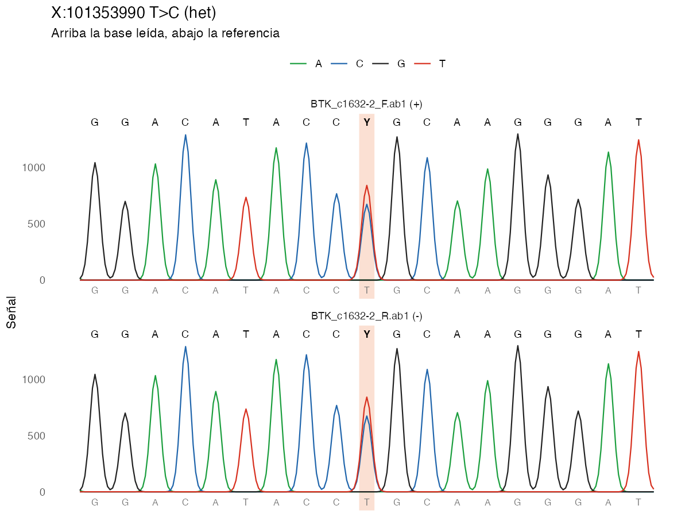
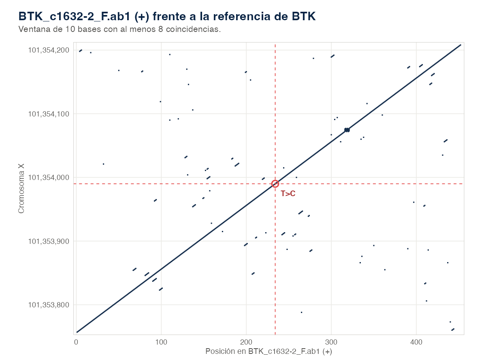
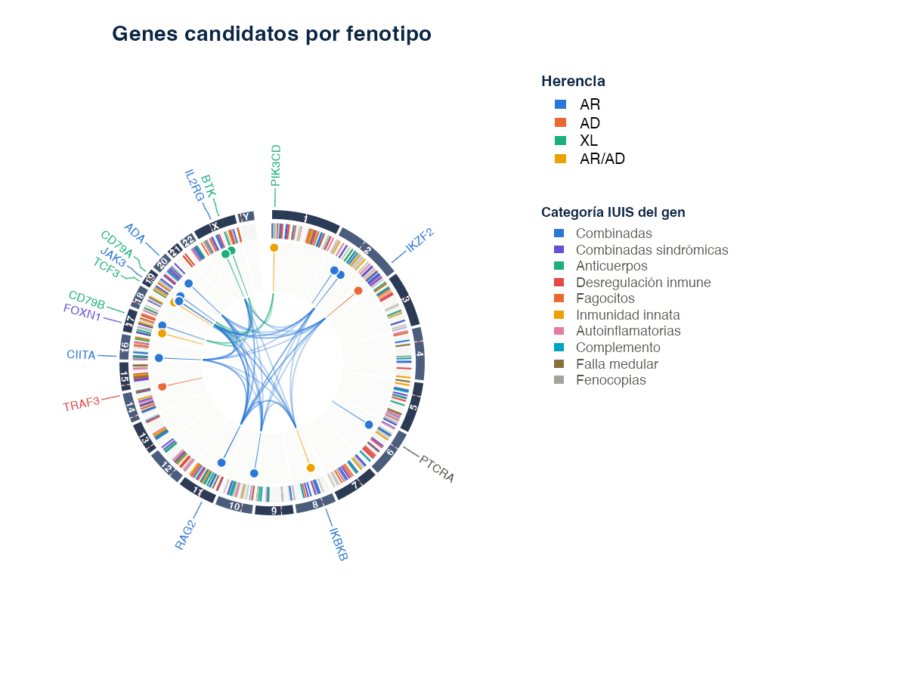
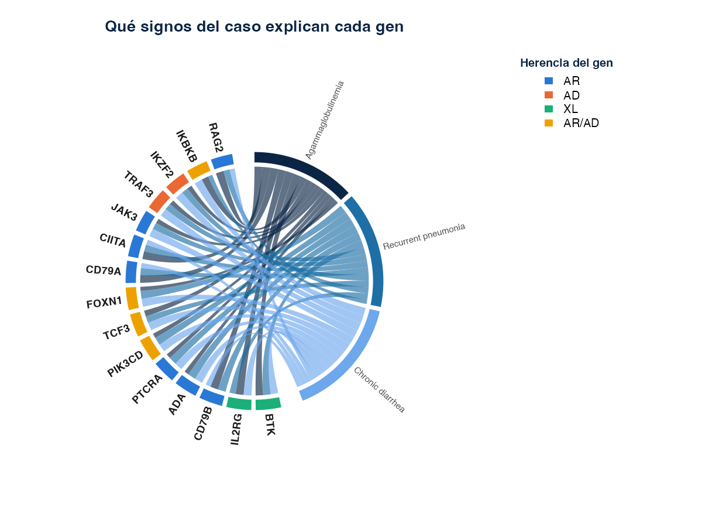
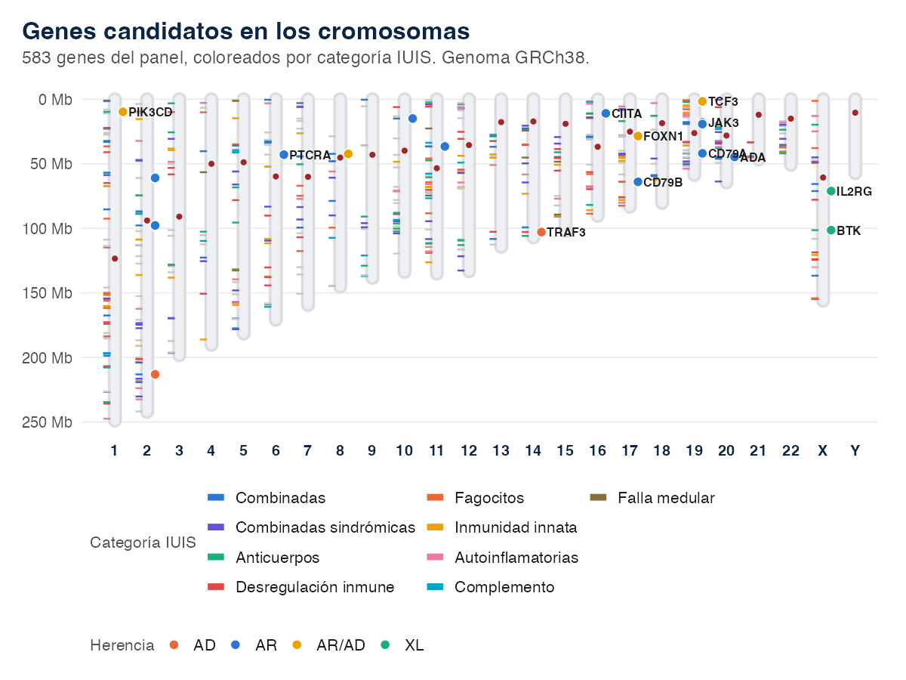
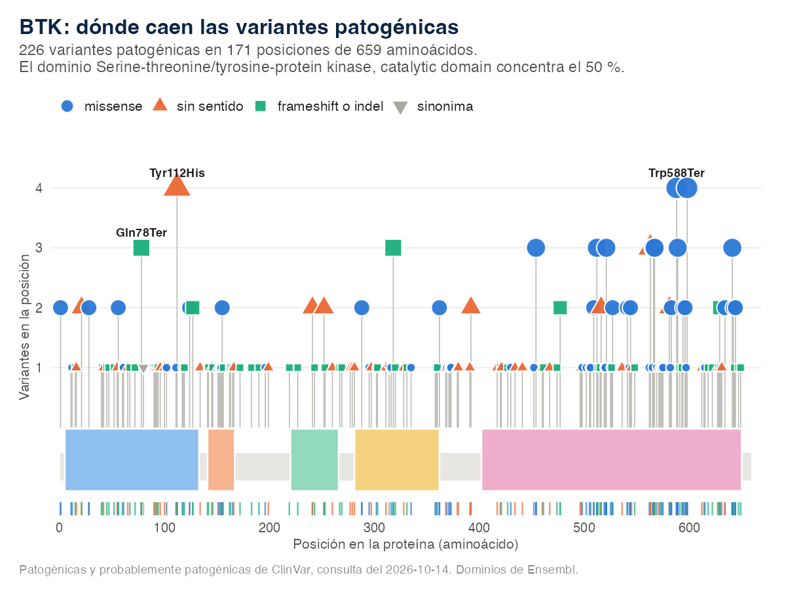

# ieiprio 

<!-- badges: start -->
[](https://github.com/Gentlenmoron/ieiprio/actions/workflows/R-CMD-check.yaml)
[](https://github.com/Gentlenmoron/ieiprio/actions/workflows/test-coverage.yaml)
[](https://gentlenmoron.github.io/ieiprio/)
[](LICENSE.md)
<!-- badges: end -->

`ieiprio` encuentra, anota y prioriza variantes en genes de errores innatos de
la inmunidad a partir de secuencias Sanger, FASTA, VCF o el texto de un
informe.

<div class="portada">
G en una portadora, con el pico doble en la posición de la variante" />
</div>

## Instalación

```r
install.packages("pak")
pak::pak("Gentlenmoron/ieiprio")
```

Con `remotes` también funciona.

```r
remotes::install_github("Gentlenmoron/ieiprio")
```

## Ejemplo

```r
library(ieiprio)
ab1 <- iei_ejemplo_sanger("het")
ref <- system.file("extdata", "btk_referencia.fa", package = "ieiprio")
v <- iei_sanger(ab1, gen = "BTK", sexo = "F", referencia = ref)
v[, c("gen", "chr", "pos", "ref", "alt", "genotipo", "qual", "ab", "lecturas")]
iei_cromatograma(v)
```

```
#> BTK_c1632-2_F.ab1: hebra +, 461 bases alineadas en X:101353757-101354217, identidad 99.8%.
#> BTK_c1632-2_R.ab1: hebra -, 461 bases alineadas en X:101353758-101354218, identidad 99.8%.
#> # A tibble: 1 × 9
#>   gen   chr         pos ref   alt   genotipo  qual    ab lecturas
#>   <chr> <chr>     <int> <chr> <chr> <chr>    <dbl> <dbl>    <int>
#> 1 BTK   X     101353990 T     C     het         45 0.445        2
```

Corre sin conexión. `iei_ejemplo_sanger()` escribe un par de cromatogramas
`.ab1` de un amplicón de BTK con la variante patogénica c.1632-2A>G en una
portadora. `iei_sanger()` los alinea contra la referencia GRCh38 que trae el
paquete y encuentra la variante en las dos hebras, con 45 % de la señal en el
alelo alternativo. El cromatograma de arriba es la salida de
`iei_cromatograma()`.

Con conexión, `iei_anotar()` y `iei_priorizar()` completan el análisis. La
variante queda en prioridad alta con su razón escrita punto por punto.

```r
iei_priorizar(iei_anotar(v), fenotipo = c("agammaglobulinemia", "neumonía recurrente"))
```

## Entradas

| Entrada | Formato | Función |
| --- | --- | --- |
| VCF | `.vcf`, `.vcf.gz`, GRCh37 o GRCh38 | `iei_leer_vcf()` |
| Cromatograma Sanger | `.ab1`, `.scf` | `iei_sanger()` |
| FASTA | `.fa`, `.fasta` | `iei_sanger()` |
| Secuencia escrita | Texto con las bases | `iei_sanger()` |
| Informe | PDF, Word o texto | `iei_variantes()` |

## Galería

<div class="galeria">






</div>

## Funciones

| Función | Qué hace |
| --- | --- |
| `iei_analizar()` | Corre el flujo completo de un VCF y deja un reporte por muestra |
| `iei_leer_vcf()`, `iei_verificar_sexo()` | Leer un VCF y comparar el sexo declarado con el del cromosoma X |
| `iei_filtrar()`, `iei_bitacora()` | Filtrar por panel y calidad, con el registro de cada paso |
| `iei_cnv()` | CNV que trae el VCF cruzadas con el panel |
| `iei_sanger()` | Llamar variantes desde `.ab1`, `.scf`, FASTA o una secuencia escrita |
| `iei_cromatograma()` | Trazas alrededor de una variante, con la base leída y la de referencia |
| `iei_dotplot()` | Dot plot de una secuencia frente a otra o frente a la referencia |
| `iei_consenso()` | Unir lecturas directa y reversa en una secuencia |
| `iei_leer_ab1()`, `iei_leer_scf()` | Leer cromatogramas |
| `iei_variantes()`, `iei_variante()` | Variantes desde PDF, Word, texto o HGVS |
| `iei_anotar()`, `iei_gnomad()` | Anotar con Ensembl VEP, ClinVar y gnomAD |
| `iei_filtrar_frecuencia()` | Descartar variantes comunes según la herencia del gen |
| `iei_priorizar()`, `iei_pesos()` | Puntaje explicado y criterios ACMG por puntos |
| `iei_reporte()` | Reporte HTML de un paciente |
| `iei_exportar()`, `iei_phenopacket()`, `iei_granges()` | Excel, VCF, BED, Phenopacket o `GRanges` |
| `iei_buscar_fenotipo()`, `iei_buscar_hpo()` | Genes del panel por parecido con el fenotipo |
| `iei_validar_fenotipo()` | Medir la búsqueda por fenotipo con casos simulados |
| `iei_gen()` | Ficha de un gen con sus variantes de ClinVar |
| `iei_circos()`, `iei_cariograma()` | Panel, candidatos o variantes sobre el genoma |
| `iei_panel()`, `iei_buscar_gen()`, `iei_fuentes()` | Panel de genes y versiones de los datos |
| `iei_app()` | Aplicación Shiny |

Las guías están en <https://gentlenmoron.github.io/ieiprio/>.
[Primeros pasos](https://gentlenmoron.github.io/ieiprio/articles/ieiprio.html)
recorre cada entrada,
[Interpretación de resultados](https://gentlenmoron.github.io/ieiprio/articles/interpretar.html)
explica el puntaje y la búsqueda por fenotipo,
[Método y parámetros](https://gentlenmoron.github.io/ieiprio/articles/metodo.html)
trae los cálculos y
[Casos de ejemplo](https://gentlenmoron.github.io/ieiprio/articles/casos.html)
tres análisis completos.

> Herramienta de apoyo e investigación. No es un informe diagnóstico ni
> reemplaza la clasificación ACMG/AMP hecha por un especialista.

## Cita

Rios Vasquez Y, Pavini N (2026). ieiprio: Priorización de variantes en genes de
errores innatos de la inmunidad. Paquete de R versión 1.0.0.
<https://github.com/Gentlenmoron/ieiprio>

`citation("ieiprio")` devuelve la referencia en BibTeX. El paquete se
distribuye con licencia MIT.
