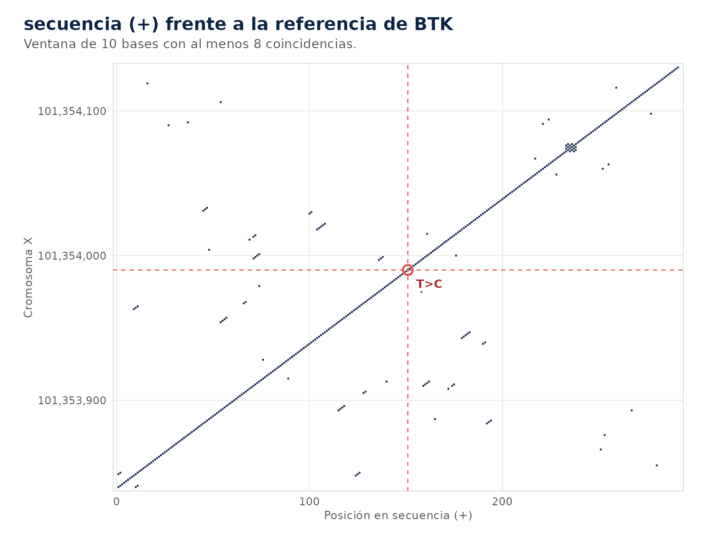
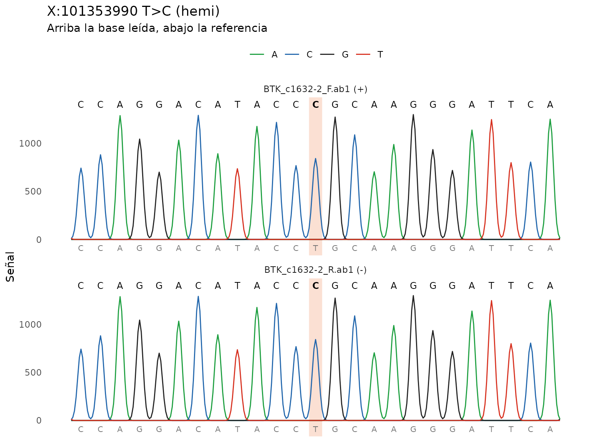
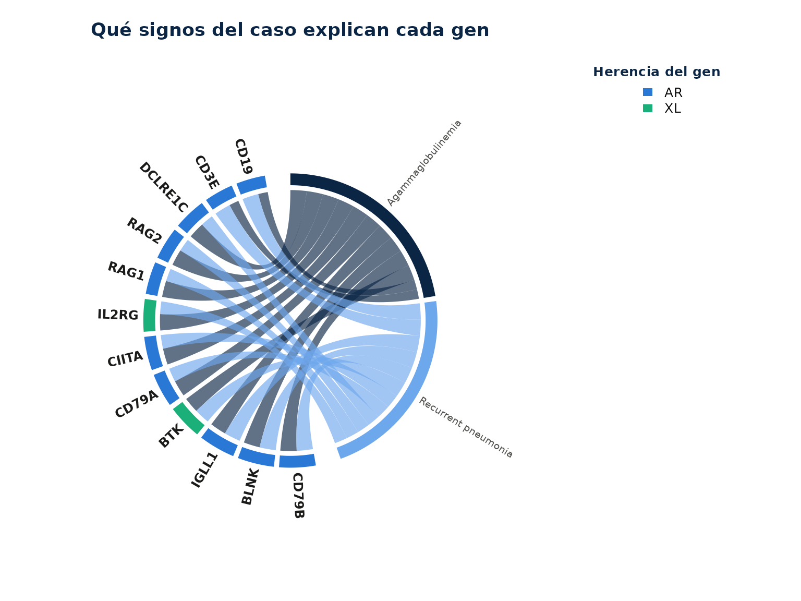
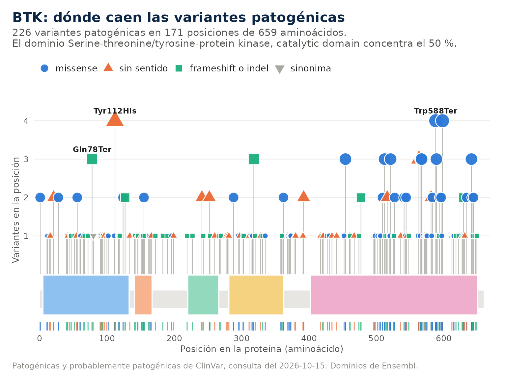

# Casos de ejemplo

Tres análisis completos con datos que se pueden copiar. Los dos primeros
corren sin conexión, porque la referencia de BTK y su anotación de
Ensembl VEP vienen dentro del paquete.

``` r

ref <- system.file("extdata", "btk_referencia.fa", package = "ieiprio")
vep <- system.file("extdata", "btk_vep.json", package = "ieiprio")
```

## 1. Una secuencia pegada como texto

Un informe de secuenciación trae la lectura de un varón como texto. Son
300 bases de BTK, de X:101353840 a X:101354139 en GRCh38, con la base
151 cambiada de T a C.

``` r

secuencia <- paste0(
  "TGTATAATCTGTGTAATCTTATCCACTTACCAAAAGCCCAAATGTCAGATTTGCTGCTGA",
  "ACTTGCTATACATCAGGACTTCCGGTGGGGACCACCGGACTGGAAATTTGGAGCCTACTG",
  "AGCTTGTGTATTCATCATCCAGGACATACCCGCAAGGGATTCAGGACTTGTTGCATTAGG",
  "ATTTGGAGGCTTGATATTTGCTTACGTTTTCTTGGCACGGTCACAAGAGTGTCACAAACA",
  "CACACAGGCTTTCTCAAAAGTCTCTCCTCCTCAACTAGTATCTTCTACAAACGTTACTTT"
)
v1 <- iei_sanger(secuencia, gen = "BTK", sexo = "M", referencia = ref)
#> secuencia: hebra +, 300 bases alineadas en X:101353840-101354139, identidad
#> 99.7%.
v1
#> # A tibble: 1 × 16
#>   muestra gen   chr       pos id    ref   alt   genotipo  qual    dp    gq    ab
#>   <chr>   <chr> <chr>   <int> <chr> <chr> <chr> <chr>    <dbl> <dbl> <dbl> <dbl>
#> 1 sanger  BTK   X      1.01e8 NA    T     C     hemi        NA    NA    NA    NA
#> # ℹ 4 more variables: filtro <chr>, build <chr>, lecturas <int>, fuente <chr>
```

``` r

iei_dotplot(v1)
```



``` r

a1 <- iei_anotar(v1, vep_json = vep)
p1 <- iei_priorizar(a1, fenotipo = c("agammaglobulinemia", "neumonía recurrente"))
#> ℹ Fenotipo interpretado como:
#> • agammaglobulinemia → HP:0004432 Agammaglobulinemia
#> • neumonía recurrente → HP:0006532 Recurrent pneumonia
iei_tabla(p1)[, c("gen", "hgvs_c", "genotipo", "consecuencia", "puntaje", "categoria", "acmg")]
#> # A tibble: 1 × 7
#>   gen   hgvs_c                     genotipo consecuencia puntaje categoria acmg 
#>   <chr> <chr>                      <chr>    <chr>          <dbl> <chr>     <chr>
#> 1 BTK   ENST00000308731.8:c.1632-… hemi     splice_acce…    13.8 alta      PVS1…
```

**Lo que deberías ver.** Una sola variante, X:101353990 T\>C, hemicigota
porque el sexo es masculino. La identidad con la referencia es 99.7 %,
una base distinta en 300. El dot plot es una diagonal continua con la
cruz roja en la posición 151 de la secuencia. La anotación la nombra
ENST00000308731.8:c.1632-2A\>G, una variante del sitio aceptor de
splicing con impacto alto, y la priorización la deja en prioridad alta
con PVS1_Strong, PM2_Supporting, PP3 y PP4. Sin conexión no hay
estrellas de ClinVar, así que la razón muestra ClinVar patogénica sin el
detalle de la revisión.

## 2. Cromatogramas directo y reverso

El mismo amplicón de BTK secuenciado en un varón afectado y en su
hermana portadora. Cada caso tiene una lectura directa y una reversa.

``` r

varon <- iei_sanger(iei_ejemplo_sanger("hemi"), gen = "BTK", sexo = "M", referencia = ref)
#> Cromatogramas de ejemplo en /tmp/Rtmpg5mOpq/sanger_1dfa3502398a.
#> BTK_c1632-2_F.ab1: hebra +, 461 bases alineadas en X:101353757-101354217,
#> identidad 99.8%.
#> BTK_c1632-2_R.ab1: hebra -, 461 bases alineadas en X:101353758-101354218,
#> identidad 99.8%.
portadora <- iei_sanger(iei_ejemplo_sanger("het"), gen = "BTK", sexo = "F", referencia = ref)
#> Cromatogramas de ejemplo en /tmp/Rtmpg5mOpq/sanger_1dfa372b7e38.
#> BTK_c1632-2_F.ab1: hebra +, 461 bases alineadas en X:101353757-101354217,
#> identidad 99.8%.
#> BTK_c1632-2_R.ab1: hebra -, 461 bases alineadas en X:101353758-101354218,
#> identidad 99.8%.
rbind(varon[, c("pos", "ref", "alt", "genotipo", "ab", "lecturas")],
      portadora[, c("pos", "ref", "alt", "genotipo", "ab", "lecturas")])
#> # A tibble: 2 × 6
#>         pos ref   alt   genotipo    ab lecturas
#>       <int> <chr> <chr> <chr>    <dbl>    <int>
#> 1 101353990 T     C     hemi     1            2
#> 2 101353990 T     C     het      0.445        2
```

``` r

iei_cromatograma(varon)
```



``` r

iei_cromatograma(portadora)
```


``` r

consenso <- iei_consenso(portadora)
consenso
#> # A tibble: 462 × 5
#>          pos ref   consenso lecturas discordante
#>        <dbl> <chr> <chr>       <int> <lgl>      
#>  1 101353757 A     A               1 FALSE      
#>  2 101353758 T     T               2 FALSE      
#>  3 101353759 T     T               2 FALSE      
#>  4 101353760 G     G               2 FALSE      
#>  5 101353761 G     G               2 FALSE      
#>  6 101353762 A     A               2 FALSE      
#>  7 101353763 A     A               2 FALSE      
#>  8 101353764 G     G               2 FALSE      
#>  9 101353765 A     A               2 FALSE      
#> 10 101353766 A     A               2 FALSE      
#> # ℹ 452 more rows
```

``` r

p2 <- iei_priorizar(iei_anotar(portadora, vep_json = vep), fenotipo = "agammaglobulinemia")
#> ℹ Fenotipo interpretado como:
#> • agammaglobulinemia → HP:0004432 Agammaglobulinemia
iei_reporte(p2, file.path(tempdir(), "portadora.html"), dominios = FALSE)
#> Reporte de "sanger" guardado en
#> /tmp/Rtmpg5mOpq/portadora.html.
```

**Lo que deberías ver.** En el varón la variante es hemicigota y la
fracción alélica es 1, porque el pico de T desaparece y solo queda C. En
la portadora es heterocigota, con cerca de 45 % de la señal en C y el
código IUPAC Y sobre la posición. Las dos lecturas de cada caso la ven,
por eso `lecturas` vale 2. El consenso es la secuencia del amplicón con
Y en la posición de la variante. En la portadora la variante queda en
prioridad alta por la evidencia de la variante, y la nota advierte que
en una mujer es portadora de un gen ligado al X. El reporte trae los dos
cromatogramas como imagen y no trae el control de calidad del VCF.

## 3. Un VCF y el fenotipo

El exoma de ejemplo de un varón con agammaglobulinemia y neumonías
recurrentes. Este caso necesita conexión para anotar.

``` r

res <- iei_analizar(iei_ejemplo_vcf(), sexo = "M",
                    fenotipo = c("agammaglobulinemia", "neumonía recurrente"),
                    carpeta = tempdir())
#> 
#> ── ieiprio ─────────────────────────────────────────────────────────────────────
#> ℹ Leyendo ejemplo.vcf.gz
#> ℹ Filtrando 4094 filas
#> ℹ Anotando 5 variantes con Ensembl VEP
#> ℹ Fenotipo interpretado como:
#> • agammaglobulinemia → HP:0004432 Agammaglobulinemia
#> • neumonía recurrente → HP:0006532 Recurrent pneumonia
#> ✔ Prioridad alta 1, media 1, baja 1
#> 
#> ✔ Reporte en /tmp/Rtmpg5mOpq/EJEMPLO01.html
iei_tabla(res)[, c("gen", "hgvs_c", "genotipo", "puntaje", "categoria", "acmg_clase")]
#> # A tibble: 3 × 6
#>   gen   hgvs_c                        genotipo puntaje categoria acmg_clase     
#>   <chr> <chr>                         <chr>      <dbl> <chr>     <chr>          
#> 1 BTK   ENST00000308731.8:c.1632-2A>G hemi        13.8 alta      Probablemente …
#> 2 RAG1  ENST00000299440.6:c.1186C>T   het          6.7 media     Probablemente …
#> 3 STAT1 NA                            het          3.6 baja      Significado in…
```

``` r

iei_circos(res)
```


La búsqueda por fenotipo no necesita red.

``` r

busqueda <- iei_buscar_fenotipo(c("agammaglobulinemia", "neumonía recurrente"), n = 12)
#> ℹ Fenotipo interpretado como:
#> • agammaglobulinemia → HP:0004432 Agammaglobulinemia
#> • neumonía recurrente → HP:0006532 Recurrent pneumonia
busqueda
#> Genes candidatos por fenotipo (enfermedad)
#> Fenotipo: HP:0004432 Agammaglobulinemia; HP:0006532 Recurrent pneumonia
#> # A tibble: 12 × 6
#>    gen     similitud especificidad enfermedad           herencia categorias_iuis
#>    <chr>       <dbl>         <dbl> <chr>                <chr>    <chr>          
#>  1 CD79B       1             0.372 Agammaglobulinemia … AR       3              
#>  2 BLNK        1             0.359 Agammaglobulinemia … AR       3              
#>  3 IGLL1       1             0.349 Agammaglobulinemia … AR       3              
#>  4 BTK         0.948         0.308 X-linked agammaglob… XL       3              
#>  5 CD79A       0.921         0.333 Agammaglobulinemia … AR       3              
#>  6 CIITA       0.921         0.277 Bare lymphocyte syn… AR       1              
#>  7 IL2RG       0.89          0.316 Severe combined imm… XL       1              
#>  8 RAG1        0.89          0.247 Omenn syndrome (OMI… AR       1              
#>  9 RAG2        0.89          0.247 Omenn syndrome (OMI… AR       1              
#> 10 DCLRE1C     0.89          0.224 Omenn syndrome (OMI… AR       1              
#> 11 CD3E        0.797         0.438 Immunodeficiency 18… AR       1              
#> 12 CD19        0.797         0.431 Immunodeficiency, c… AR       3
#> Detalle de cada coincidencia en la columna coincidencias. Grafico: plot(x) o
#> autoplot(x).
```

``` r

plot(busqueda, tipo = "acordes")
```



``` r

btk <- iei_gen("BTK")
btk
#> 
#> ── BTK ──
#> 
#> • Herencia: XL ─ evidencia en PanelApp: verde
#> • Mecanismo: pérdida de función o no especificado
#> • Categoría IUIS: 3 Deficiencias predominantemente de anticuerpos (PanelApp,
#> tabla IUIS)
#> • Alias: ATK, PSCTK1, XLA
#> • Ubicación: X:101,349,447-101,390,796 (GRCh38)
#> • Fenotipos en PanelApp: Agammaglobulinemia and isolated hormone deficiency;
#> Agammaglobulinemia, X-linked; Agammaglobulinemia, X-linked 1 (y 6 mas)
#> • HPO: 77 términos; los más específicos: Complete or near-complete absence of
#> specific antibody response to protein-conjugated Haemophilus influenzae type b
#> vaccine, Enteroviral dermatomyositis syndrome, Enteroviral hepatitis,
#> Bronchiolitis obliterans, Lymph node hypoplasia, Recurrent enteroviral
#> infections
#> • Proteína ENSP00000308176: 659 aa, dominios Pleckstrin homology domain, Zinc
#> finger, Btk motif, SH3 domain, SH2 domain, Serine-threonine/tyrosine-protein
#> kinase, catalytic domain
#> • ClinVar (2026-10-15): patogenica 433, probablemente patogenica 136,
#> significado incierto 220, probablemente benigna 230, benigna 72
#> • Patogénicas y probablemente patogénicas por tipo: frameshift o indel 111,
#> missense 90, sin sentido 57, splicing 46, otra 44, sinonima 2
#> • Donde se concentran en la proteína: Serine-threonine/tyrosine-protein kinase,
#> catalytic domain 112, Pleckstrin homology domain 46, fuera de dominios 23, SH2
#> domain 22, Zinc finger, Btk motif 15, SH3 domain 8
#> Grafico: plot(x) o autoplot(x); variantes de ClinVar en x$clinvar$variantes.
plot(btk)
```



**Lo que deberías ver.** De las cinco variantes de ClinVar del ejemplo
quedan tres. BTK c.1632-2A\>G queda primera en prioridad alta, con clase
ACMG probablemente patogénica. RAG1 c.1186C\>T queda en prioridad media,
el tope para un portador, con la nota que pide buscar una segunda
variante. STAT1 queda en prioridad baja, y las dos benignas salen en los
filtros de frecuencia y de ClinVar. En el círculo BTK es el punto más
alejado del centro, sobre el cromosoma X. La búsqueda por fenotipo pone
arriba a los genes de agammaglobulinemia, CD79B, BLNK, IGLL1, BTK y
CD79A, todos con similitud cercana a 1, y en el diagrama de cuerdas cada
uno recibe cuerdas de los dos signos. La ficha de BTK muestra la
herencia ligada al X, la categoría de deficiencias de anticuerpos y las
variantes patogénicas de ClinVar sobre la proteína, con el dominio
quinasa como el que más concentra.

## 4. Para seguir practicando

Los tres casos usan BTK. La sección 11 de [Primeros
pasos](https://gentlenmoron.github.io/ieiprio/articles/ieiprio.md) reúne
un banco de doce variantes reales en otros genes, la forma de simular
pacientes desde las enfermedades de HPO, cómo armar secuencias propias a
partir de la referencia y las fuentes públicas que entran en el paquete.
