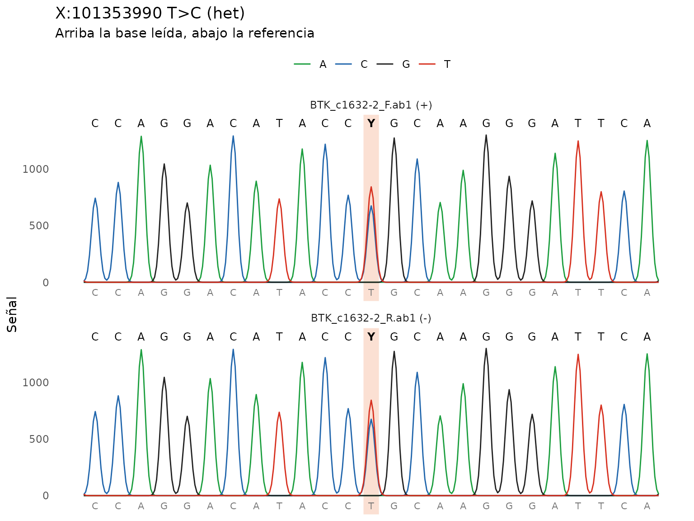
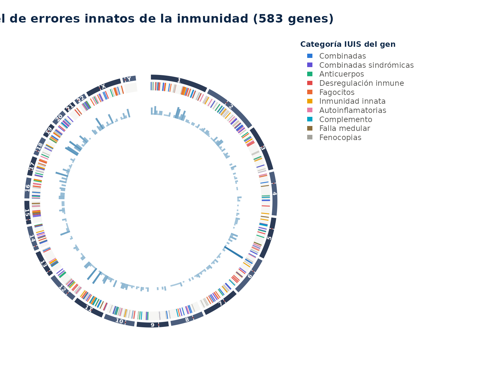
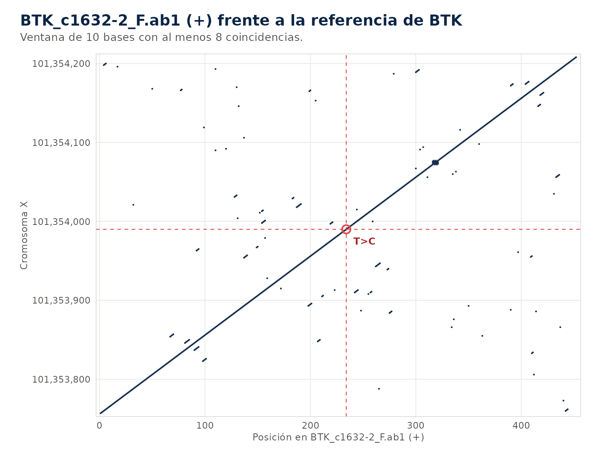
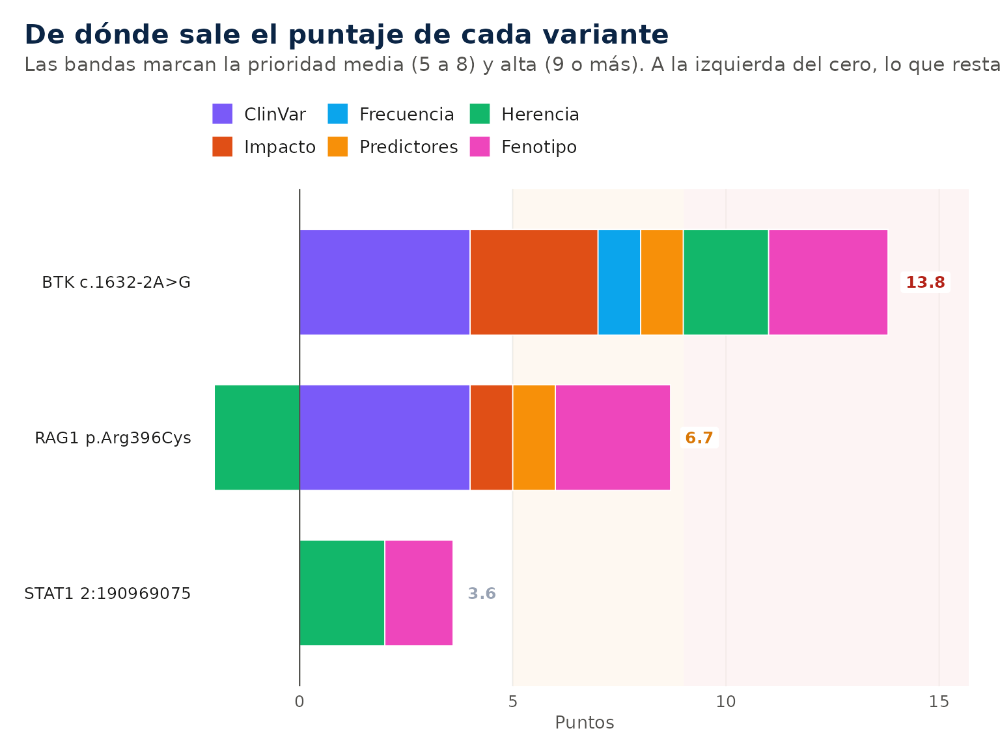
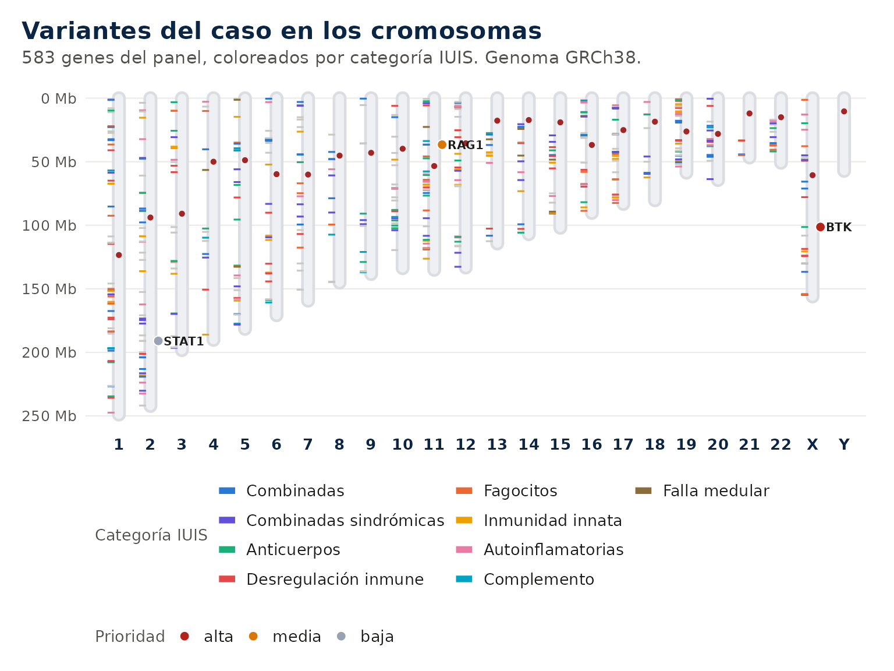
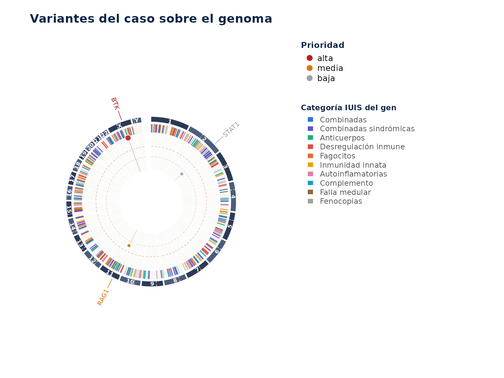

# Primeros pasos

**Ejemplo mínimo.** Dos cromatogramas de BTK de una portadora, sin
conexión.

``` r

ab1 <- iei_ejemplo_sanger("het")
#> Cromatogramas de ejemplo en /tmp/Rtmp8mUYNl/sanger_1d26a34b165.
ref <- system.file("extdata", "btk_referencia.fa", package = "ieiprio")
v <- iei_sanger(ab1, gen = "BTK", sexo = "F", referencia = ref)
#> BTK_c1632-2_F.ab1: hebra +, 461 bases alineadas en X:101353757-101354217,
#> identidad 99.8%.
#> BTK_c1632-2_R.ab1: hebra -, 461 bases alineadas en X:101353758-101354218,
#> identidad 99.8%.
v
#> # A tibble: 1 × 16
#>   muestra gen   chr       pos id    ref   alt   genotipo  qual    dp    gq    ab
#>   <chr>   <chr> <chr>   <int> <chr> <chr> <chr> <chr>    <dbl> <dbl> <dbl> <dbl>
#> 1 sanger  BTK   X      1.01e8 NA    T     C     het         45    NA    NA 0.445
#> # ℹ 4 more variables: filtro <chr>, build <chr>, lecturas <int>, fuente <chr>
iei_cromatograma(v)
```



La variante es X:101353990 T\>C, que en el transcrito MANE de BTK es
c.1632-2A\>G. Las dos lecturas la ven como pico doble.

## 1. Qué hace el paquete

`ieiprio` ordena y explica variantes en los genes de los errores innatos
de la inmunidad. Recibe un VCF, cromatogramas Sanger, un FASTA, una
secuencia escrita o el texto de un informe. Anota cada variante con
Ensembl VEP, ClinVar y gnomAD, la prioriza según la evidencia y el
fenotipo del caso y devuelve una tabla con el motivo de cada punto, los
criterios ACMG/AMP sugeridos y un reporte HTML por paciente.

Solo usa lo que sale de la secuencia y de bases de datos curadas. No
recibe antecedentes familiares ni exámenes clínicos, porque no se pueden
verificar en la secuencia y vuelven el análisis menos reproducible.

La guía [Interpretación de
resultados](https://gentlenmoron.github.io/ieiprio/articles/interpretar.md)
explica cómo leer la salida, [Método y
parámetros](https://gentlenmoron.github.io/ieiprio/articles/metodo.md)
describe los cálculos y [Casos de
ejemplo](https://gentlenmoron.github.io/ieiprio/articles/casos.md) trae
tres análisis completos para copiar.

> Herramienta de apoyo e investigación. No es un informe diagnóstico ni
> reemplaza la clasificación ACMG/AMP hecha por un especialista.

## 2. Fundamentos

### 2.1 Los errores innatos de la inmunidad

Los errores innatos de la inmunidad (EII) son enfermedades causadas por
variantes en genes del desarrollo o la función del sistema inmune. Se
conocen más de 500, casi todas monogénicas. Se manifiestan como
infecciones graves o recurrentes, autoinmunidad, autoinflamación,
alergia grave, linfoproliferación o susceptibilidad al cáncer. La misma
enfermedad puede deberse a genes distintos y un mismo gen puede dar
cuadros diferentes, por eso el genotipo se cruza siempre con el
fenotipo.

Una variante altera el gen de dos maneras. En la pérdida de función la
proteína falta o no trabaja. En la ganancia de función trabaja de más o
de otra forma, como STAT1 en la candidiasis mucocutánea crónica o PIK3CD
en el síndrome de PI3K delta activada. El mecanismo cambia qué variantes
se esperan, porque una variante nula no produce una enfermedad por
ganancia de función.

| Herencia | Qué se espera encontrar | Ejemplo |
|----|----|----|
| Autosómica recesiva (AR) | Dos variantes en el gen, homocigotas o una en cada copia | RAG1, ADA, DCLRE1C |
| Autosómica dominante (AD) | Una variante basta | STAT3, CTLA4, NFKB1 |
| Ligada al X (XL) | Una variante hemicigota en el varón | BTK, CYBB, WAS, IL2RG |
| Mitocondrial (MT) | Variante en el ADN mitocondrial | Raras en EII |

### 2.2 La clasificación IUIS

El comité de expertos de la International Union of Immunological
Societies clasifica los EII en diez categorías según el componente del
sistema inmune afectado. El paquete asigna cada gen del panel a su
categoría, la usa como alternativa al fenotipo HPO y le da color a los
gráficos.

| Categoría | Grupo | Genes representativos |
|----|----|----|
| 1 | Inmunodeficiencias que afectan la inmunidad celular y humoral | RAG1, RAG2, IL2RG, ADA |
| 2 | Inmunodeficiencias combinadas con rasgos sindrómicos | WAS, ATM, STAT3 |
| 3 | Deficiencias predominantemente de anticuerpos | BTK, CD79A, TNFRSF13B |
| 4 | Enfermedades de desregulación inmune | FOXP3, PRF1, CTLA4 |
| 5 | Defectos congénitos de fagocitos | CYBB, NCF1, ELANE |
| 6 | Defectos de la inmunidad intrínseca e innata | IFNGR1, IL12RB1, STAT1 |
| 7 | Enfermedades autoinflamatorias | MEFV, NLRP3, TREX1 |
| 8 | Deficiencias del complemento | C1QA, C2, CFH |
| 9 | Falla medular | DKC1, GATA2 |
| 10 | Fenocopias de EII | Autoanticuerpos y variantes somáticas |

``` r

iei_circos()
```



El anillo exterior son los cromosomas. El siguiente marca cada gen del
panel con el color de su categoría y el interior cuenta cuántos genes
hay en cada región.

### 2.3 Tecnologías de secuenciación

Cada tecnología mira una parte distinta del genoma y deja huecos
distintos.

| Tecnología | Qué detecta bien | Qué se le escapa | Entrada en ieiprio |
|----|----|----|----|
| Sanger | Variantes puntuales e indels en un amplicón | Deleciones del amplicón entero, mosaicos bajos | [`iei_sanger()`](https://gentlenmoron.github.io/ieiprio/reference/iei_sanger.md) |
| Panel de genes | Variantes en los genes elegidos con alta cobertura | Genes fuera del panel | [`iei_leer_vcf()`](https://gentlenmoron.github.io/ieiprio/reference/iei_leer_vcf.md) |
| Exoma | Variantes en casi todos los exones | Intrones profundos, promotores, CNV pequeñas | [`iei_leer_vcf()`](https://gentlenmoron.github.io/ieiprio/reference/iei_leer_vcf.md) |
| Genoma | Exones, intrones y CNV con cobertura pareja | Regiones repetitivas y pseudogenes | [`iei_leer_vcf()`](https://gentlenmoron.github.io/ieiprio/reference/iei_leer_vcf.md) |

### 2.4 Del archivo a la variante

Un VCF describe cada posición con el cromosoma, la posición, el alelo de
referencia y el alternativo. Para cada muestra trae el genotipo (`0/1`
heterocigoto, `1/1` homocigoto) y medidas de calidad. La profundidad
(DP) es el número de lecturas que cubren la posición. La calidad del
genotipo (GQ) es la confianza del programa en ese genotipo en escala
Phred. La fracción alélica (AB) es la proporción de lecturas con el
alelo alternativo, que ronda 0.5 en un heterocigoto verdadero. Una
fracción baja sugiere un artefacto o un mosaico.

La calidad Phred expresa la probabilidad de error como
$`Q = -10 \log_{10} p`$. Q20 es un error en 100 y Q30 uno en 1000. La
misma escala mide la calidad de cada base en un cromatograma Sanger.

## 3. Instalación

`ieiprio` necesita R 4.2 o más nuevo y se instala desde GitHub.

``` r

install.packages("pak")
pak::pak("Gentlenmoron/ieiprio")
```

Las dependencias obligatorias son cli, httr2, jsonlite, rlang y tibble.
Las demás se usan en tareas puntuales y el paquete avisa cuando falta
alguna.

| Paquete          | Uso                                              |
|------------------|--------------------------------------------------|
| ggplot2, plotly  | Gráficos estáticos e interactivos                |
| circlize         | Genoma en círculo y diagramas de cuerdas         |
| patchwork        | Paneles combinados, como el oncoplot             |
| ragg             | Imágenes de los cromatogramas dentro del reporte |
| pdftools, xml2   | Lectura de informes en PDF y Word                |
| writexl          | Exportación a Excel                              |
| shiny, bslib, DT | Aplicación interactiva                           |
| GenomicRanges    | Conversión a `GRanges`                           |

``` r

library(ieiprio)
```

## 4. Privacidad y trabajo sin conexión

Para anotar, el paquete consulta servicios públicos y les envía solo
coordenadas genómicas o nombres de genes. El código de la muestra, el
fenotipo y el archivo completo nunca salen de la computadora.

| Servicio | Datos enviados | Uso |
|----|----|----|
| Ensembl VEP | Cromosoma, posición y alelos | Consecuencia, HGVS, frecuencias y predictores |
| Ensembl REST | Región o gen | Secuencia de referencia y dominios de proteína |
| NCBI ClinVar | Nombre del gen | Variantes conocidas del gen |
| gnomAD | Variante y nombre del gen | Homocigotos sanos, FAF95 y restricción |
| PanelApp | Número del panel | Actualización del panel |

Con `options(ieiprio.sin_red = TRUE)` ninguna función consulta servicios
externos y los campos que dependen de ellos quedan vacíos. La búsqueda
por fenotipo, el filtrado, la priorización y el reporte funcionan igual,
porque PanelApp y HPO vienen dentro del paquete. Para Sanger se pasa la
referencia en `referencia` y para anotar se usa la salida de un VEP
local en `vep_json`.

``` r

options(ieiprio.sin_red = TRUE)
```

Las respuestas de cada servicio quedan en una caché en la carpeta de
usuario de R, así que repetir un análisis no vuelve a consultar.
[`iei_limpiar_cache()`](https://gentlenmoron.github.io/ieiprio/reference/iei_limpiar_cache.md)
la borra.

## 5. Datos de entrada

Todas las entradas terminan en la misma tabla, con una fila por
variante. Lo que sigue funciona igual sin importar el origen.

| Entrada | Formatos | Función |
|----|----|----|
| Secuenciación masiva | VCF y VCF comprimido, GRCh37 o GRCh38 | [`iei_leer_vcf()`](https://gentlenmoron.github.io/ieiprio/reference/iei_leer_vcf.md) |
| Secuenciación Sanger | `.ab1`, `.scf`, FASTA o secuencia escrita | [`iei_sanger()`](https://gentlenmoron.github.io/ieiprio/reference/iei_sanger.md) |
| Informes | PDF, Word, texto o variantes en HGVS | [`iei_variantes()`](https://gentlenmoron.github.io/ieiprio/reference/iei_variantes.md) |

Conviene indicar siempre el sexo. En un varón, una variante homocigota
en el X fuera de las regiones pseudoautosómicas pasa a hemicigota, y esa
distinción decide la lectura de genes como BTK, CYBB o WAS.

El paquete trae dos ejemplos.
[`iei_ejemplo_vcf()`](https://gentlenmoron.github.io/ieiprio/reference/iei_ejemplo_vcf.md)
es un exoma ficticio de un varón con hipogammaglobulinemia e infecciones
recurrentes, con cinco variantes reales de ClinVar y unas 4000 de fondo.
[`iei_ejemplo_sanger()`](https://gentlenmoron.github.io/ieiprio/reference/iei_ejemplo_sanger.md)
escribe los cromatogramas directo y reverso de un amplicón de BTK con la
variante causal del mismo caso, a partir de la referencia GRCh38 que
viene en `inst/extdata/btk_referencia.fa`.

| Rol | Gen | Variante | ClinVar |
|----|----|----|----|
| Causal | BTK | c.1632-2A\>G | [265455](https://www.ncbi.nlm.nih.gov/clinvar/variation/265455/) |
| Portador | RAG1 | c.1186C\>T (p.Arg396Cys) | [13144](https://www.ncbi.nlm.nih.gov/clinvar/variation/13144/) |
| Incierta | STAT1 | c.\*1628A\>G | [333246](https://www.ncbi.nlm.nih.gov/clinvar/variation/333246/) |
| Benigna | BTK | c.\*334T\>G | [367692](https://www.ncbi.nlm.nih.gov/clinvar/variation/367692/) |
| Benigna | CYBB | c.1314+19C\>T | [35968](https://www.ncbi.nlm.nih.gov/clinvar/variation/35968/) |

## 6. Análisis de un VCF

### 6.1 Lectura

``` r

vcf <- iei_leer_vcf(iei_ejemplo_vcf(), sexo = "M")
vcf
#> # A tibble: 4,094 × 15
#>    muestra   chr       pos id    ref   alt   genotipo  qual    dp    gq    ab
#>    <chr>     <chr>   <int> <chr> <chr> <chr> <chr>    <dbl> <dbl> <dbl> <dbl>
#>  1 EJEMPLO01 1     1605175 NA    G     C     hom_alt    234    52    74 1    
#>  2 EJEMPLO01 1     1617029 NA    T     A     hom_alt    315    45    99 1    
#>  3 EJEMPLO01 1     2547757 NA    C     T     hom_alt    667    43    90 1    
#>  4 EJEMPLO01 1     3239502 NA    G     C     het        780    46    83 0.630
#>  5 EJEMPLO01 1     4235075 NA    A     C     het        245    56    99 0.625
#>  6 EJEMPLO01 1     4256441 NA    A     G     hom_alt    296    16    82 1    
#>  7 EJEMPLO01 1     6010805 NA    C     T     hom_alt    278    26    77 1    
#>  8 EJEMPLO01 1     6129328 NA    T     C     het        400     9    75 0.556
#>  9 EJEMPLO01 1     6429026 NA    A     G     het        695    68    74 0.5  
#> 10 EJEMPLO01 1     6891176 NA    A     G     het        891    36    83 0.611
#> # ℹ 4,084 more rows
#> # ℹ 4 more variables: filtro <chr>, build <chr>, gt <chr>, ps <chr>
```

### 6.2 Verificación del sexo

``` r

iei_verificar_sexo(vcf)
#> # A tibble: 1 × 6
#>   muestra   sexo_declarado sexo_inferido frac_het_x n_variantes_x concordante
#>   <chr>     <chr>          <chr>              <dbl>         <int> <lgl>      
#> 1 EJEMPLO01 M              M                      0           139 TRUE
```

El sexo declarado se compara con el que se estima por la proporción de
heterocigotos en el cromosoma X. Una discrepancia sugiere un error de
identidad de la muestra.

### 6.3 Filtrado

``` r

filtrado <- iei_filtrar(vcf)
iei_bitacora(filtrado)
#> # A tibble: 4 × 3
#>   paso     filas descartadas
#>   <chr>    <int>       <int>
#> 1 Inicial   4094           0
#> 2 Genotipo  4094           0
#> 3 Panel        5        4089
#> 4 Calidad      5           0
```

Quedan las variantes en genes del panel con buena calidad técnica. Por
defecto son los genes con evidencia verde del panel 398 de PanelApp,
profundidad de al menos 10 lecturas, calidad de genotipo de 20 y
fracción alélica de 0.2 en heterocigotos. La bitácora cuenta cuántas
variantes quedan en cada paso.

### 6.4 Anotación

``` r

anotado <- iei_anotar(filtrado)
#> Consultando Ensembl VEP (GRCh38) para 5 variantes.
anotado <- iei_filtrar_frecuencia(anotado)
anotado[, c("gen", "hgvs_c", "consecuencia", "af_gnomad", "clinvar")]
#> # A tibble: 3 × 5
#>   gen   hgvs_c                        consecuencia             af_gnomad clinvar
#>   <chr> <chr>                         <chr>                        <dbl> <chr>  
#> 1 STAT1 NA                            downstream_gene_variant  0.0000263 uncert…
#> 2 RAG1  ENST00000299440.6:c.1186C>T   missense_variant         0.0000376 pathog…
#> 3 BTK   ENST00000308731.8:c.1632-2A>G splice_acceptor_variant NA         pathog…
```

La anotación agrega la consecuencia en el transcrito, la nomenclatura
HGVS, la frecuencia en gnomAD, ClinVar y los predictores REVEL,
AlphaMissense y SpliceAI. El filtro de frecuencia descarta después las
variantes demasiado comunes para una enfermedad rara, con un corte que
depende de la herencia del gen.

### 6.5 Priorización

``` r

prior <- iei_priorizar(anotado, fenotipo = c("agammaglobulinemia", "neumonía recurrente"))
#> ℹ Fenotipo interpretado como:
#> • agammaglobulinemia → HP:0004432 Agammaglobulinemia
#> • neumonía recurrente → HP:0006532 Recurrent pneumonia
prior
#> Resultado de ieiprio • 1 muestra, 3 variantes
#> Genoma GRCh38 • Ensembl VEP 116 • prioridad alta 1, media 1, baja 1
#> # A tibble: 3 × 8
#>   muestra   gen   hgvs_c      hgvs_p      genotipo puntaje categoria acmg       
#>   <chr>     <chr> <chr>       <chr>       <chr>      <dbl> <chr>     <chr>      
#> 1 EJEMPLO01 BTK   c.1632-2A>G NA          hemi        13.8 alta      PVS1_Stron…
#> 2 EJEMPLO01 RAG1  c.1186C>T   p.Arg396Cys het          6.7 media     PM1_Suppor…
#> 3 EJEMPLO01 STAT1 NA          NA          het          3.6 baja      PM2_Suppor…
```

La variante de BTK queda en prioridad alta. Rompe el sitio aceptor de
splicing, ClinVar la clasifica como patogénica, falta en gnomAD y es
hemicigota en un gen ligado al X. La de RAG1 queda en prioridad media,
que es el tope para una sola variante en un gen recesivo, y la de STAT1
queda baja por estar en la región 3’ no traducida. Las dos benignas
salen en el filtro de frecuencia o en el de ClinVar.

### 6.6 Reporte

``` r

iei_reporte(prior, file.path(tempdir(), "EJEMPLO01.html"), paciente = "EJEMPLO01")
#> Reporte de "EJEMPLO01" guardado en
#> /tmp/Rtmp8mUYNl/EJEMPLO01.html.
```

El argumento `paciente` es el código de la muestra y nunca un nombre.
Con un VCF el reporte trae el control de calidad, la tabla priorizada,
una ficha por variante con el diagrama de la proteína, la coincidencia
con el fenotipo, el embudo del filtrado y las versiones de todas las
fuentes.

### 6.7 Todo en una llamada

``` r

res <- iei_analizar(iei_ejemplo_vcf(), sexo = "M", fenotipo = "agammaglobulinemia", carpeta = tempdir())
#> 
#> ── ieiprio ─────────────────────────────────────────────────────────────────────
#> ℹ Leyendo ejemplo.vcf.gz
#> ℹ Filtrando 4094 filas
#> ℹ Anotando 5 variantes con Ensembl VEP
#> ℹ Fenotipo interpretado como:
#> • agammaglobulinemia → HP:0004432 Agammaglobulinemia
#> ✔ Prioridad alta 1, media 1, baja 1
#> 
#> ✔ Reporte en /tmp/Rtmp8mUYNl/EJEMPLO01.html
```

[`iei_analizar()`](https://gentlenmoron.github.io/ieiprio/reference/iei_analizar.md)
corre los pasos anteriores y deja un reporte por muestra en la carpeta
indicada.

## 7. Análisis de secuencias Sanger

``` r

sanger <- iei_sanger(iei_ejemplo_sanger(), gen = "BTK", sexo = "M", referencia = ref)
#> Cromatogramas de ejemplo en /tmp/Rtmp8mUYNl/sanger_1d2635283a0.
#> BTK_c1632-2_F.ab1: hebra +, 461 bases alineadas en X:101353757-101354217,
#> identidad 99.8%.
#> BTK_c1632-2_R.ab1: hebra -, 461 bases alineadas en X:101353758-101354218,
#> identidad 99.8%.
sanger
#> # A tibble: 1 × 16
#>   muestra gen   chr       pos id    ref   alt   genotipo  qual    dp    gq    ab
#>   <chr>   <chr> <chr>   <int> <chr> <chr> <chr> <chr>    <dbl> <dbl> <dbl> <dbl>
#> 1 sanger  BTK   X      1.01e8 NA    T     C     hemi        45    NA    NA     1
#> # ℹ 4 more variables: filtro <chr>, build <chr>, lecturas <int>, fuente <chr>
```

[`iei_sanger()`](https://gentlenmoron.github.io/ieiprio/reference/iei_sanger.md)
recorta los extremos de baja calidad, ubica cada lectura en su hebra, la
alinea contra la referencia y llama variantes homocigotas, heterocigotas
por picos dobles e indels. Sin `referencia` baja la secuencia del gen o
la región desde Ensembl y la guarda en caché.

``` r

iei_cromatograma(sanger)
```


Cada traza tiene el color de su base. La franja marca la variante,
arriba va la base leída y abajo la de referencia. Las lecturas reversas
se muestran ya complementadas y en el sentido del genoma.

``` r

iei_dotplot(sanger)
```



El dot plot compara la lectura con la referencia por ventanas de 10
bases. La diagonal continua dice que la lectura cubre la referencia sin
cortes. Una indel se vería como un salto de la diagonal, y la cruz roja
marca la variante.

Una indel heterocigota produce picos dobles sostenidos desde el punto
del cambio. El paquete prueba los desfases posibles y llama la indel si
uno de ellos explica los picos.
[`iei_consenso()`](https://gentlenmoron.github.io/ieiprio/reference/iei_consenso.md)
reúne las lecturas en una sola secuencia. Desde aquí el flujo es el
mismo que con un VCF.

``` r

vep <- system.file("extdata", "btk_vep.json", package = "ieiprio")
iei_priorizar(iei_anotar(sanger, vep_json = vep), fenotipo = "agammaglobulinemia")
#> ℹ Fenotipo interpretado como:
#> • agammaglobulinemia → HP:0004432 Agammaglobulinemia
#> Resultado de ieiprio • 1 muestra, 1 variante
#> 
#> Genoma GRCh38 • Ensembl VEP local • prioridad alta 1, media 0, baja 0
#> # A tibble: 1 × 8
#>   muestra gen   hgvs_c      hgvs_p genotipo puntaje categoria acmg              
#>   <chr>   <chr> <chr>       <chr>  <chr>      <dbl> <chr>     <chr>             
#> 1 sanger  BTK   c.1632-2A>G NA     hemi          14 alta      PVS1_Strong, PM2_…
```

`btk_vep.json` es la respuesta de Ensembl VEP para esta variante,
guardada para que el ejemplo corra sin red. Con conexión basta
`iei_anotar(sanger)`.

## 8. Variantes desde informes

``` r

iei_extraer_variantes(c(
  "Se identificó NM_000061.3(BTK):c.1632-2A>G en hemicigosis.",
  "También RAG1 p.Arg396Cys en heterocigosis y rs121908711."
))
#> # A tibble: 3 × 4
#>   entrada                 tipo            genotipo linea
#>   <chr>                   <chr>           <chr>    <int>
#> 1 NM_000061.3:c.1632-2A>G hgvs_transcrito hemi         1
#> 2 rs121908711             rsid            het          2
#> 3 RAG1:p.Arg396Cys        gen_y_cambio    het          2
```

[`iei_variantes()`](https://gentlenmoron.github.io/ieiprio/reference/iei_variantes.md)
lee PDF, Word o texto y reconoce nomenclatura HGVS, rsID y el gen
seguido del cambio. Si el texto dice el genotipo, lo usa. Para una sola
variante,
[`iei_variante()`](https://gentlenmoron.github.io/ieiprio/reference/iei_variante.md)
la ubica, la anota, la prioriza y muestra su ficha.

``` r

iei_variante("BTK c.1632-2A>G", genotipo = "hemi", fenotipo = "agammaglobulinemia")
#> ℹ Sin transcrito, "BTK:c.1632-2A>G" corresponde a varias posiciones. Al anotar
#>   se conserva la que coincide con esa nomenclatura en el transcrito MANE.
#> ℹ Para evitarlo, indica el transcrito: "NM_000061.3:c.1632-2A>G".
#> ℹ Fenotipo interpretado como:
#> • agammaglobulinemia → HP:0004432 Agammaglobulinemia
#> 
#> 
#> ── BTK c.1632-2A>G ──
#> 
#> 
#> 
#> • Proteina: -
#> 
#> • Consecuencia: splice acceptor variant (HIGH)
#> 
#> • gnomAD: ausente | ClinVar: pathogenic
#> 
#> • Predictores: SpliceAI 0.99
#> 
#> • Herencia del gen: XL | Genotipo: hemi
#> 
#> • Fenotipos del gen: Agammaglobulinemia and isolated hormone deficiency;
#>   Agammaglobulinemia, X-linked; Agammaglobulinemia, X-linked 1 (y 6 mas)
#> 
#> → Puntaje 14 (alta): ClinVar patogénica (+4); impacto alto (+3); ausente en
#>   gnomAD (+1); predictores a favor (SpliceAI 0.99) (+1); hemicigota en gen
#>   ligado al X (+2); fenotipo parecido con Agammaglobulinemia, X-linked
#>   (OMIM:300755), similitud 1.00 y 1 de 1 términos exactos (+3)
#> 
#> → ACMG sugerido: PVS1_Strong, PM2_Supporting, PP3, PP4
```

## 9. CNV del VCF

``` r

head(genes_dificiles[, c("gen", "tipo")], 8)
#> # A tibble: 8 × 2
#>   gen   tipo                   
#>   <chr> <chr>                  
#> 1 NCF1  pseudogen              
#> 2 IKBKG pseudogen              
#> 3 SBDS  pseudogen              
#> 4 PMS2  pseudogen              
#> 5 C4A   numero de copias       
#> 6 C4B   numero de copias       
#> 7 CFH   duplicacion segmentaria
#> 8 CFHR1 duplicacion segmentaria
```

Algunas causas frecuentes de inmunodeficiencia no son variantes
puntuales, como la deleción 22q11.2 o las deleciones grandes de BTK y
CYBB. Si el VCF trae CNV llamadas por otro programa como registros
simbólicos (`<DEL>`, `<DUP>`),
[`iei_cnv()`](https://gentlenmoron.github.io/ieiprio/reference/iei_cnv.md)
las cruza con el panel y el reporte las muestra. Los genes con
pseudogenes o con número de copias variable están en `genes_dificiles`,
y la nota de cada variante lo advierte.

## 10. Salidas

``` r

summary(prior)
#> 
#> ── Resumen de ieiprio ──
#> 
#> Genoma GRCh38, Ensembl VEP 116
#> 
#> ── Variantes por prioridad
#> categoria
#>  alta media  baja 
#>     1     1     1
#> 
#> ── Por muestra
#> # A tibble: 1 × 5
#>   muestra    alta media  baja principal
#>   <chr>     <int> <int> <int> <chr>    
#> 1 EJEMPLO01     1     1     1 BTK
#> 
#> ── Genes con mayor puntaje
#> # A tibble: 3 × 4
#>   gen   variantes mejor_puntaje mejor_categoria
#>   <chr>     <int>         <dbl> <chr>          
#> 1 BTK           1          13.8 alta           
#> 2 RAG1          1           6.7 media          
#> 3 STAT1         1           3.6 baja
#> 
#> ── Criterios ACMG sugeridos
#> # A tibble: 6 × 2
#>   criterio       variantes
#>   <chr>              <int>
#> 1 PM2_Supporting         3
#> 2 PP3                    2
#> 3 PP4                    2
#> 4 PM1_Supporting         1
#> 5 PM5                    1
#> 6 PVS1_Strong            1
#> 
#> ── Filtrado
#> # A tibble: 6 × 3
#>   paso            filas descartadas
#>   <chr>           <int>       <int>
#> 1 Inicial          4094           0
#> 2 Genotipo         4094           0
#> 3 Panel               5        4089
#> 4 Calidad             5           0
#> 5 Frecuencia          3           2
#> 6 ClinVar benigna     3           0
plot(prior)
```



El resultado de
[`iei_priorizar()`](https://gentlenmoron.github.io/ieiprio/reference/iei_priorizar.md)
es una tabla, así que se filtra y se grafica con las herramientas
habituales de R. Las variantes también se ven sobre los cromosomas o
sobre el genoma en círculo. En el cariograma cada raya a la izquierda de
un cromosoma es un gen del panel y cada punto a la derecha una variante
del caso. En el círculo la distancia al centro es el puntaje.

``` r

plot(prior, tipo = "cariotipo")
```



``` r

plot(prior, tipo = "circos")
```



[`iei_exportar()`](https://gentlenmoron.github.io/ieiprio/reference/iei_exportar.md)
elige el formato por la extensión. Excel guarda variantes, parámetros y
fuentes en hojas separadas, VCF y BED sirven para IGV y JSON produce un
Phenopacket de GA4GH que leen Exomiser y LIRICAL.

``` r

iei_exportar(prior, "EJEMPLO01.xlsx")
iei_exportar(prior, "EJEMPLO01.json")
```

La aplicación interactiva reúne la búsqueda por fenotipo, la ficha de
gen, la interpretación de una variante, el análisis de archivos con
descarga del reporte y la validación de la búsqueda por fenotipo.

``` r

iei_app()
```

## 11. Limitaciones

El paquete analiza variantes puntuales e indels pequeñas. Las CNV y las
variantes estructurales aparecen solo si el VCF ya las trae llamadas, y
la cobertura no se evalúa porque requiere el BAM. En Sanger no se
detectan mosaicos por debajo del umbral de pico doble, y una indel
heterocigota llamada por deconvolución se confirma con la otra hebra. Si
el VCF no trae fase, dos heterocigotas en un gen recesivo quedan como un
posible compuesto. Los criterios ACMG y su clase son sugerencias para un
especialista, y la similitud de fenotipo se validó con casos simulados y
no con una cohorte clínica.
