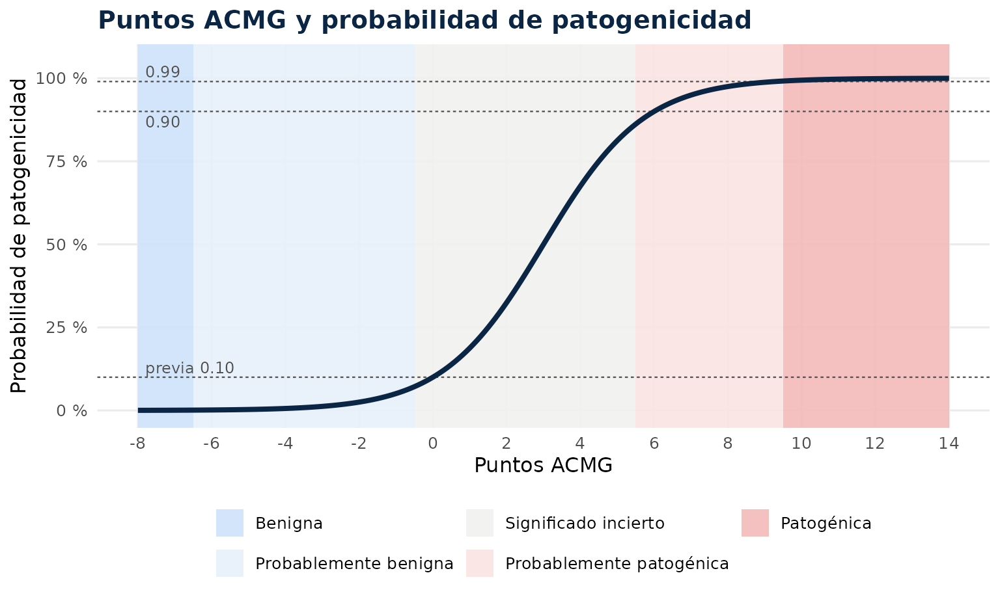
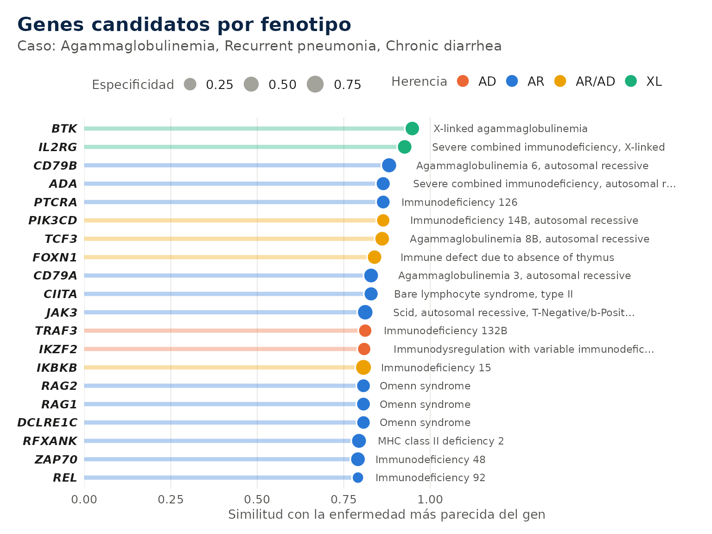
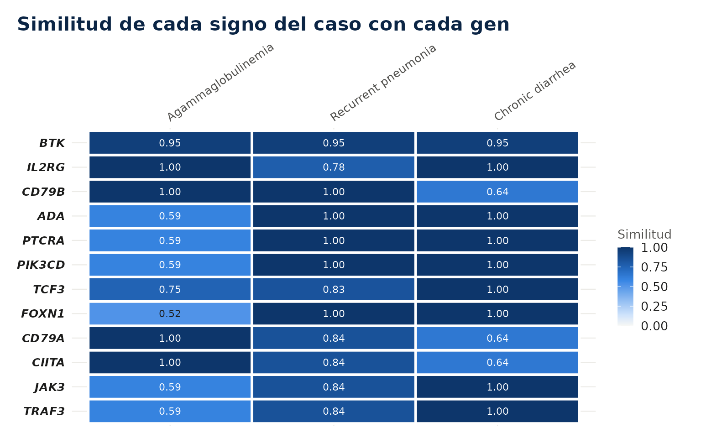
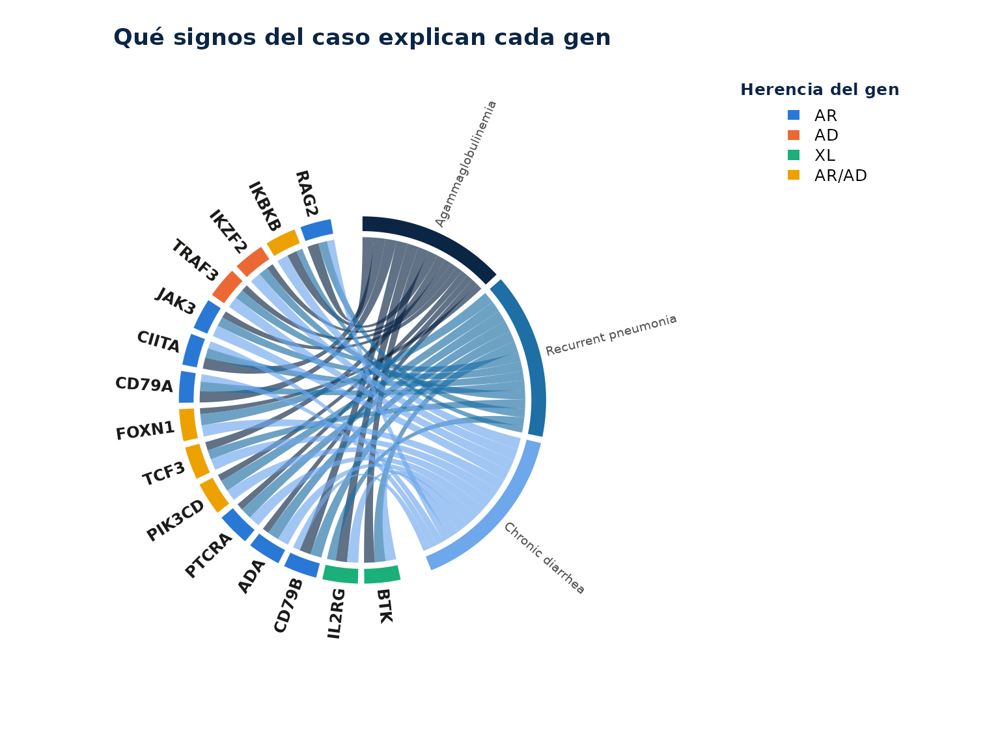
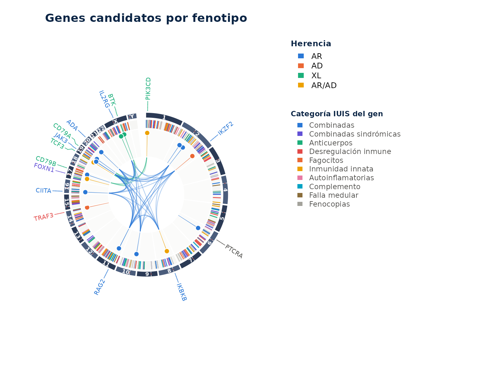
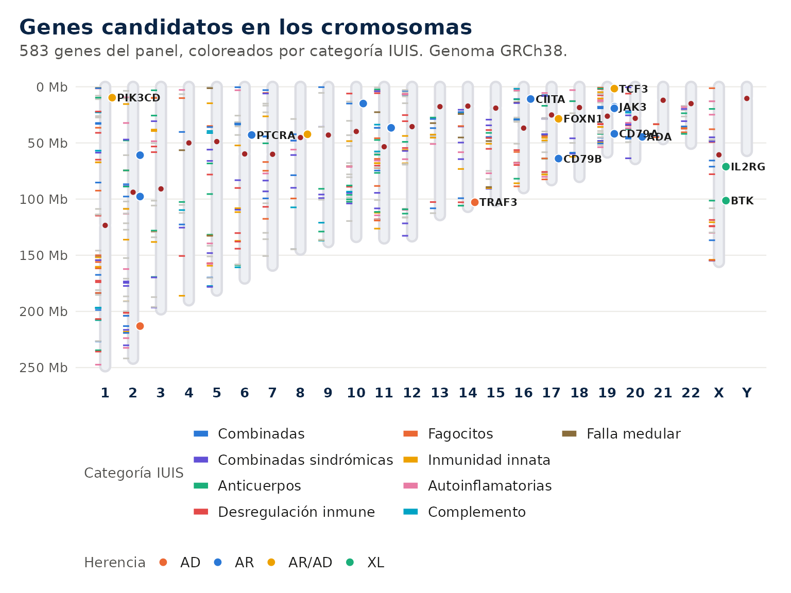
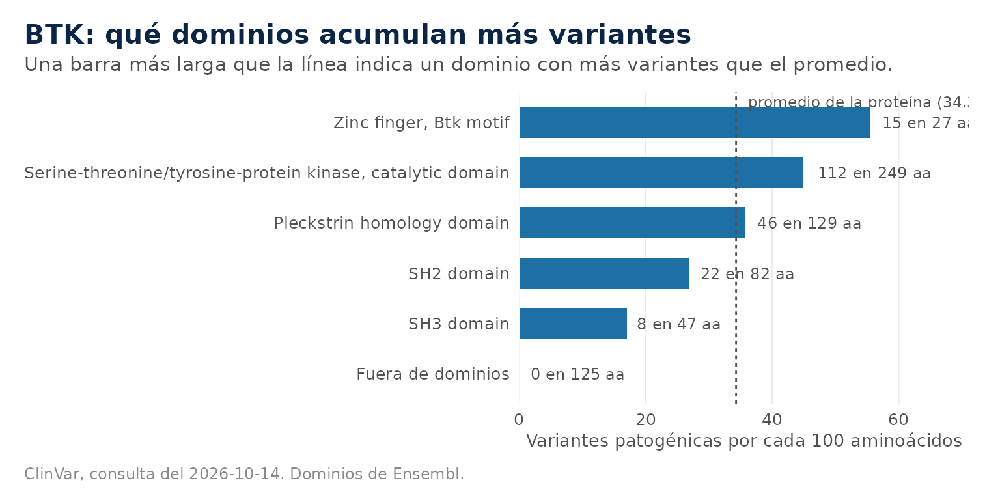

# Interpretación de resultados

**Ejemplo mínimo.** Genes del panel que mejor explican un caso, sin
conexión.

``` r

iei_buscar_fenotipo(c("agammaglobulinemia", "neumonía recurrente"), n = 5)
#> ℹ Fenotipo interpretado como:
#> • agammaglobulinemia → HP:0004432 Agammaglobulinemia
#> • neumonía recurrente → HP:0006532 Recurrent pneumonia
#> Genes candidatos por fenotipo (enfermedad)
#> 
#> Fenotipo: HP:0004432 Agammaglobulinemia; HP:0006532 Recurrent pneumonia
#> # A tibble: 5 × 6
#>   gen   similitud especificidad enfermedad              herencia categorias_iuis
#>   <chr>     <dbl>         <dbl> <chr>                   <chr>    <chr>          
#> 1 CD79B     1             0.372 Agammaglobulinemia 6, … AR       3              
#> 2 BLNK      1             0.359 Agammaglobulinemia 4, … AR       3              
#> 3 IGLL1     1             0.349 Agammaglobulinemia 2, … AR       3              
#> 4 BTK       0.948         0.308 X-linked agammaglobuli… XL       3              
#> 5 CD79A     0.921         0.333 Agammaglobulinemia 3, … AR       3
#> Detalle de cada coincidencia en la columna coincidencias. Grafico: plot(x) o
#> autoplot(x).
```

Arriba quedan los genes de agammaglobulinemia, CD79B, BLNK, IGLL1, BTK y
CD79A, con similitud cercana a 1. La columna `enfermedad` nombra la
enfermedad más parecida de cada gen.

## 1. Caso de trabajo

La guía usa una tabla anotada armada a mano, con cinco variantes de un
varón con agammaglobulinemia y neumonías recurrentes, para que corra sin
conexión.

``` r

anotado <- tibble::tibble(
  muestra = "P01",
  gen = c("BTK", "RAG1", "RAG1", "CYBB", "NCF1"),
  chr = c("X", "11", "11", "X", "7"),
  pos = c(101354013L, 36573500L, 36574100L, 38050000L, 74779000L),
  ref = "C", alt = "T",
  genotipo = c("hemi", "het", "het", "hemi", "het"),
  impacto = c("HIGH", "MODERATE", "HIGH", "LOW", "HIGH"),
  consecuencia = c("splice_acceptor_variant", "missense_variant", "stop_gained",
                   "synonymous_variant", "frameshift_variant"),
  af_gnomad = c(NA, 2e-5, NA, 0.004, NA),
  clinvar = c("pathogenic", NA, NA, NA, NA),
  clinvar_estrellas = c(2L, NA, NA, NA, NA),
  revel = c(NA, 0.82, NA, NA, NA),
  exon = c(NA, "2/2", "2/2", "9/13", "4/11"),
  hgvs_c = c("ENST1:c.1632-2A>G", "ENST2:c.1186C>T", "ENST2:c.1871G>A", "ENST3:c.1314C>T", "ENST4:c.75delG"),
  hgvs_p = c(NA, "ENSP2:p.Arg396Cys", "ENSP2:p.Trp624Ter", "ENSP3:p.Leu438=", "ENSP4:p.Tyr26fs")
)
attr(anotado, "ieiprio_sexo") <- c(P01 = "M")
prior <- iei_priorizar(anotado, fenotipo = c("agammaglobulinemia", "neumonía recurrente"))
#> ℹ Fenotipo interpretado como:
#> • agammaglobulinemia → HP:0004432 Agammaglobulinemia
#> • neumonía recurrente → HP:0006532 Recurrent pneumonia
prior
#> Resultado de ieiprio • 1 muestra, 5 variantes
#> Genoma ? • Ensembl VEP ? • prioridad alta 1, media 2, baja 2
#> # A tibble: 5 × 8
#>   muestra gen   hgvs_c      hgvs_p      genotipo puntaje categoria acmg         
#>   <chr>   <chr> <chr>       <chr>       <chr>      <dbl> <chr>     <chr>        
#> 1 P01     BTK   c.1632-2A>G NA          hemi        12.8 alta      PVS1_Strong,…
#> 2 P01     RAG1  c.1871G>A   p.Trp624Ter het          8.7 media     PVS1_Moderat…
#> 3 P01     RAG1  c.1186C>T   p.Arg396Cys het          6.7 media     PM2_Supporti…
#> 4 P01     CYBB  c.1314C>T   p.Leu438=   hemi         4.3 baja      BS1          
#> 5 P01     NCF1  c.75delG    p.Tyr26fs   het          4.3 baja      PVS1, PM2_Su…
```

## 2. Estructura del resultado

El resultado conserva todas las columnas de la anotación y agrega las de
la priorización. Las más importantes son las siguientes.

| Columna | Contenido | Uso |
|----|----|----|
| `puntaje` | Suma de todos los componentes | Ordena la revisión; no es una clasificación |
| `categoria` | Alta, media o baja | Indica por dónde empezar |
| `razones` | Origen de cada punto | Es la columna que siempre se lee |
| `p_clinvar` a `p_fenotipo` | Desglose por componente | Muestra si el puntaje viene de una o de varias fuentes |
| `acmg` | Criterios ACMG/AMP sugeridos | Punto de partida de la clasificación |
| `acmg_puntos`, `acmg_clase` | Suma de Tavtigian y su clase | Orientativa, cambia al agregar evidencia |
| `nota` | Advertencias que no cambian el puntaje | Portador, fase sin confirmar, gen difícil, mosaico |

[`iei_tabla()`](https://gentlenmoron.github.io/ieiprio/reference/iei_tabla.md)
devuelve una versión simple con las columnas principales.

``` r

iei_tabla(prior)[, c("gen", "puntaje", "categoria", "acmg", "acmg_clase")]
#> # A tibble: 5 × 5
#>   gen   puntaje categoria acmg                                        acmg_clase
#>   <chr>   <dbl> <chr>     <chr>                                       <chr>     
#> 1 BTK      12.8 alta      PVS1_Strong, PM2_Supporting, PP4            Probablem…
#> 2 RAG1      8.7 media     PVS1_Moderate, PM2_Supporting, PM3_Support… Significa…
#> 3 RAG1      6.7 media     PM2_Supporting, PM3_Supporting, PP3, PP4    Significa…
#> 4 CYBB      4.3 baja      BS1                                         Probablem…
#> 5 NCF1      4.3 baja      PVS1, PM2_Supporting                        Probablem…
```

## 3. Lectura de las razones

Cada razón lleva su aporte entre paréntesis.

``` r

cat(prior$razones[1])
#> ClinVar patogénica, 2 estrellas (+4); impacto alto (+3); ausente en gnomAD (+1); hemicigota en gen ligado al X (+2); fenotipo parecido con X-linked agammaglobulinemia (ORPHA:47), similitud 0.95 y 2 de 2 términos exactos (+2.8)
```

En la primera variante el puntaje combina ClinVar con dos estrellas, un
impacto alto en el splicing, la ausencia en gnomAD, un genotipo
hemicigoto compatible con un gen ligado al X y un fenotipo parecido al
de la agammaglobulinemia ligada al X. Son cinco fuentes independientes
que apuntan en la misma dirección, que es el perfil de una variante
causal.

## 4. Conducta según el tipo de variante

### 4.1 Candidata principal

Una variante en prioridad alta con varias razones independientes es la
candidata principal. El siguiente paso es confirmarla por un método
independiente y completar la clasificación ACMG con la evidencia que el
paquete no ve.

### 4.2 Dos heterocigotas en un gen recesivo

El paquete las marca como posible heterocigoto compuesto y sugiere
PM3_Supporting. El criterio completo exige saber que las variantes están
en alelos distintos. El paquete lo lee de la fase del propio VCF
(genotipos con `|` y el mismo bloque `PS`), y en ese caso marca el
compuesto en trans y sugiere PM3, o descarta el par si las dos están en
cis.

``` r

prior[prior$gen == "RAG1", c("genotipo", "acmg", "nota")]
#> # A tibble: 2 × 3
#>   genotipo acmg                                               nota              
#>   <chr>    <chr>                                              <chr>             
#> 1 het      PVS1_Moderate, PM2_Supporting, PM3_Supporting, PP4 Posible heterocig…
#> 2 het      PM2_Supporting, PM3_Supporting, PP3, PP4           Posible heterocig…
```

### 4.3 Una heterocigota en un gen recesivo

Corresponde a un portador y nunca pasa de prioridad media, porque una
sola variante no explica una enfermedad recesiva. Si el fenotipo encaja
bien, la segunda variante puede estar donde un exoma no mira, como una
CNV, una región intrónica profunda o el promotor.

### 4.4 Genes con pseudogenes

NCF1, IKBKG, SBDS y PMS2 tienen pseudogenes casi idénticos, y otros
genes varían en número de copias. En ellos una variante puede venir del
pseudogén y la ausencia de variantes no descarta el gen. La nota de la
variante lo indica.

``` r

prior$nota[prior$gen == "NCF1"]
#> [1] "Portador en gen recesivo; buscar segunda variante (CNV, intrónica) si el fenotipo encaja. NCF1 tiene dos pseudogenes (NCF1B y NCF1C) idénticos en un 99.5 %; su variante más común (c.75_76delGT) no se detecta bien con lecturas cortas. Un resultado negativo no descarta enfermedad granulomatosa crónica por NCF1."
```

### 4.5 Prioridad baja

Incluye sinónimas sin efecto predicho en el splicing, variantes
frecuentes y variantes sin relación con el fenotipo. No se descartan,
quedan en una sección desplegable del reporte.

## 5. Clasificación ACMG por puntos

### 5.1 Los criterios y su fuerza

El estándar ACMG/AMP de 2015 describe 28 criterios, cada uno con una
dirección (a favor de patogénica o de benigna) y una fuerza (muy fuerte,
fuerte, moderada o de apoyo). Las reglas originales combinaban los
criterios con una lista de casos. ClinGen propone sumarlos en puntos. Un
criterio muy fuerte vale 8, uno fuerte 4, uno moderado 2 y uno de apoyo
1, y los benignos restan lo mismo.

| Puntos            | Clase                    |
|-------------------|--------------------------|
| 10 o más          | Patogénica               |
| 6 a 9             | Probablemente patogénica |
| 0 a 5             | Significado incierto     |
| −1 a −6           | Probablemente benigna    |
| −7 o menos, o BA1 | Benigna                  |

``` r

prior[, c("gen", "acmg", "acmg_puntos", "acmg_clase")]
#> # A tibble: 5 × 4
#>   gen   acmg                                              acmg_puntos acmg_clase
#>   <chr> <chr>                                                   <dbl> <chr>     
#> 1 BTK   PVS1_Strong, PM2_Supporting, PP4                            6 Probablem…
#> 2 RAG1  PVS1_Moderate, PM2_Supporting, PM3_Supporting, P…           5 Significa…
#> 3 RAG1  PM2_Supporting, PM3_Supporting, PP3, PP4                    4 Significa…
#> 4 CYBB  BS1                                                        -4 Probablem…
#> 5 NCF1  PVS1, PM2_Supporting                                        9 Probablem…
```

### 5.2 El marco bayesiano

Los puntos no son arbitrarios. Tavtigian y colaboradores (2018)
mostraron que las reglas ACMG se comportan como un clasificador
bayesiano. Se parte de una probabilidad previa de patogenicidad de 0.10
y cada criterio multiplica las chances por una razón de verosimilitud.
Un criterio muy fuerte equivale a una razón de 350, y las fuerzas
menores son raíces de ese valor.

``` math
\text{Odds} = 350^{\,n_{ap}/8 \,+\, n_{mod}/4 \,+\, n_{f}/2 \,+\, n_{mf}}, \qquad P = \frac{\text{Odds} \cdot 0.1}{(\text{Odds} - 1)\cdot 0.1 + 1}
```

donde $`n_{ap}`$, $`n_{mod}`$, $`n_{f}`$ y $`n_{mf}`$ son el número de
criterios de apoyo, moderados, fuertes y muy fuertes a favor de
patogenicidad.

Como cada exponente es un múltiplo de 1/8, la suma de puntos es
directamente el exponente multiplicado por 8. Con 10 puntos la
probabilidad posterior supera 0.99, el umbral de patogénica, y con 6
puntos supera 0.90, el de probablemente patogénica.



### 5.3 Lo que el paquete no ve

El paquete sugiere solo los criterios que puede decidir con la secuencia
y las bases de datos. No conoce los estudios funcionales (PS3), el
número de pacientes no relacionados con la variante (PS4), la
segregación ni el origen de novo (PP1, BS4, PS2, PM6), ni las reglas
específicas de ClinGen para cada gen. La clase es un punto de partida
para el especialista.

## 6. Búsqueda por fenotipo

### 6.1 Términos HPO

La Human Phenotype Ontology asigna un código a cada signo clínico y los
ordena de lo general a lo específico. No es una lista ni un árbol sino
un grafo dirigido sin ciclos, en el que un término puede tener varios
padres. Neumonía recurrente es a la vez una infección respiratoria
recurrente y una anomalía del pulmón. La regla del camino verdadero dice
que si un paciente tiene un término, también tiene todos sus ancestros,
y es lo que permite comparar fenotipos parecidos aunque no sean
idénticos.

Cada término tiene un contenido de información que mide qué tan raro es.
Un término que comparten pocos genes, como agammaglobulinemia, informa
mucho; uno que comparten casi todos, como anomalía del sistema inmune,
informa poco. La similitud entre dos términos es la información del
ancestro común más específico, y por eso dos signos emparentados de
cerca valen casi lo mismo que dos idénticos.

``` r

iei_buscar_hpo("neumonia")
#> # A tibble: 15 × 4
#>    hpo_id     termino                                       genes_panel    ic
#>    <chr>      <chr>                                               <int> <dbl>
#>  1 HP:0006532 Recurrent pneumonia                                    83  3.49
#>  2 HP:0002090 Pneumonia                                              68  2.72
#>  3 HP:0020102 Pneumocystis jirovecii pneumonia                       12  6.09
#>  4 HP:0006538 Recurrent bronchopulmonary infections                  10  5.74
#>  5 HP:0031950 Usual interstitial pneumonia                            6  5.86
#>  6 HP:0002100 Recurrent aspiration pneumonia                          4  5.04
#>  7 HP:0005366 Recurrent streptococcus pneumoniae infections           4  7.18
#>  8 HP:0011949 Acute infectious pneumonia                              3  6.78
#>  9 HP:0006527 Lymphocytic interstitial pneumonia                      3  7.18
#> 10 HP:0011945 Bronchiolitis obliterans organizing pneumonia           2  7.88
#> 11 HP:0011951 Aspiration pneumonia                                    1  3.9 
#> 12 HP:0033670 Organizing pneumonia                                    1  8.57
#> 13 HP:0033214 Recurrent viral pneumonia                               1  8.57
#> 14 HP:5210428 HSV pneumonia                                           0  8.57
#> 15 HP:5210302 VZV pneumonitis                                         0  8.57
```

La columna `genes_panel` indica cuántos genes del panel tienen el
término y `ic` mide su especificidad. Todas las funciones que reciben un
fenotipo aceptan texto y muestran cómo lo interpretaron, así que no es
necesario buscar los códigos antes.

### 6.2 Genes candidatos

[`iei_buscar_fenotipo()`](https://gentlenmoron.github.io/ieiprio/reference/iei_buscar_fenotipo.md)
compara el caso con cada enfermedad de los genes del panel y ordena los
genes por la enfermedad más parecida, que aparece en la columna
`enfermedad`.

``` r

b <- iei_buscar_fenotipo(c("agammaglobulinemia", "neumonía recurrente", "diarrea crónica"))
#> ℹ Fenotipo interpretado como:
#> • agammaglobulinemia → HP:0004432 Agammaglobulinemia
#> • neumonía recurrente → HP:0006532 Recurrent pneumonia
#> • diarrea crónica → HP:0002028 Chronic diarrhea
b
#> Genes candidatos por fenotipo (enfermedad)
#> Fenotipo: HP:0004432 Agammaglobulinemia; HP:0006532 Recurrent pneumonia;
#> HP:0002028 Chronic diarrhea
#> # A tibble: 20 × 6
#>    gen     similitud especificidad enfermedad           herencia categorias_iuis
#>    <chr>       <dbl>         <dbl> <chr>                <chr>    <chr>          
#>  1 BTK         0.948         0.341 X-linked agammaglob… XL       3              
#>  2 IL2RG       0.926         0.348 Severe combined imm… XL       1              
#>  3 CD79B       0.881         0.404 Agammaglobulinemia … AR       3              
#>  4 ADA         0.864         0.301 Severe combined imm… AR       1              
#>  5 PTCRA       0.864         0.271 Immunodeficiency 12… AR       NA             
#>  6 PIK3CD      0.864         0.24  Immunodeficiency 14… AR/AD    3              
#>  7 TCF3        0.861         0.355 Agammaglobulinemia … AR/AD    3              
#>  8 FOXN1       0.839         0.337 Immune defect due t… AR/AD    2              
#>  9 CD79A       0.829         0.367 Agammaglobulinemia … AR       3              
#> 10 CIITA       0.829         0.305 Bare lymphocyte syn… AR       1              
#> 11 JAK3        0.812         0.447 Scid, autosomal rec… AR       1              
#> 12 TRAF3       0.812         0.235 Immunodeficiency 13… AD       4;7            
#> 13 IKZF2       0.809         0.235 Immunodysregulation… AD       1              
#> 14 IKBKB       0.807         0.492 Immunodeficiency 15… AR/AD    1              
#> 15 RAG2        0.807         0.273 Omenn syndrome (OMI… AR       1              
#> 16 RAG1        0.807         0.272 Omenn syndrome (OMI… AR       1              
#> 17 DCLRE1C     0.807         0.25  Omenn syndrome (OMI… AR       1              
#> 18 RFXANK      0.794         0.381 MHC class II defici… AR       1              
#> 19 ZAP70       0.791         0.362 Immunodeficiency 48… AR       1;4            
#> 20 REL         0.791         0.107 Immunodeficiency 92… AR       NA
#> Detalle de cada coincidencia en la columna coincidencias. Grafico: plot(x) o
#> autoplot(x).
```

La `similitud` va de 0 a 1. Cuando varios genes llegan al máximo, la
`especificidad` desempata a favor del gen cuyo fenotipo conocido gira en
torno a lo descrito. La columna `coincidencias` muestra con qué término
de la enfermedad se emparejó cada signo del caso.

``` r

b$coincidencias[b$gen == "BTK"]
#> [1] "Agammaglobulinemia (igual); Recurrent pneumonia (igual); Chronic diarrhea (igual)"
```

``` r

plot(b)
```



### 6.3 Cómo ver la búsqueda

El mapa muestra la similitud de cada signo del caso con cada gen y
permite ver qué signo sostiene a cada candidato.

``` r

plot(b, tipo = "mapa", n = 12)
```



El diagrama de cuerdas cuenta lo mismo con otra forma. Cada signo del
caso está a la derecha y cada gen a la izquierda, y el grosor de la
cuerda es la similitud entre ambos. Un gen con muchas cuerdas gruesas
explica varios signos a la vez.

``` r

plot(b, tipo = "acordes")
```



Sobre el genoma, cada candidato es una barra tan alta como su similitud
y del color de su herencia. Los candidatos que comparten categoría IUIS
se unen por dentro, de modo que un grupo de líneas del mismo color
indica que varios genes de una misma familia de enfermedades explican el
caso.

``` r

iei_circos(b)
```



El cariograma ubica a los mismos candidatos en los cromosomas, con los
genes del panel a la izquierda de cada uno.

``` r

iei_cariograma(b)
```



### 6.4 Signos ausentes

Un signo que el paciente no tiene también orienta. Un varón con
trombocitopenia e infecciones recurrentes sin eccema encaja mejor con la
trombocitopenia ligada al X que con el síndrome de Wiskott-Aldrich
completo, aunque ambos son del gen WAS. Cada signo ausente resta según
su frecuencia en la enfermedad.

``` r

iei_buscar_fenotipo(c("trombocitopenia", "infecciones recurrentes"), ausentes = "eccema", n = 8)
#> ℹ Fenotipo interpretado como:
#> • trombocitopenia → HP:0001873 Thrombocytopenia
#> • infecciones recurrentes → HP:0002719 Recurrent infections
#> ℹ Fenotipo interpretado como:
#> • eccema → HP:0000964 Eczematoid dermatitis
#> Genes candidatos por fenotipo (enfermedad)
#> 
#> Fenotipo: HP:0001873 Thrombocytopenia; HP:0002719 Recurrent infections
#> 
#> Ausentes: HP:0000964 Eczematoid dermatitis
#> # A tibble: 8 × 6
#>   gen    similitud especificidad enfermedad             herencia categorias_iuis
#>   <chr>      <dbl>         <dbl> <chr>                  <chr>    <chr>          
#> 1 VPS45          1         0.325 Neutropenia, severe c… AR       5              
#> 2 IRF8           1         0.322 Immunodeficiency 32B,… AR/AD    6              
#> 3 ITK            1         0.283 Lymphoproliferative s… AR       4              
#> 4 LRBA           1         0.256 Immunodeficiency, com… AR       4              
#> 5 LCK            1         0.253 Immunodeficiency 22 (… AR       1              
#> 6 SH2D1A         1         0.253 Lymphoproliferative s… XL       4              
#> 7 MAGT1          1         0.244 Immunodeficiency, X-l… XL       4              
#> 8 XIAP           1         0.231 Lymphoproliferative s… XL       4
#> Detalle de cada coincidencia en la columna coincidencias. Grafico: plot(x) o
#> autoplot(x).
```

### 6.5 Significancia estadística

Un gen con un fenotipo muy amplio puede quedar arriba con casi cualquier
descripción. Con `p_valor = TRUE` la similitud de cada gen se compara
con la que obtiene frente a fenotipos al azar del mismo tamaño. Un valor
p bajo indica que el parecido es propio del caso.

``` r

iei_buscar_fenotipo(c("agammaglobulinemia", "neumonía recurrente"), n = 6, p_valor = TRUE, permutaciones = 100)
#> ℹ Fenotipo interpretado como:
#> • agammaglobulinemia → HP:0004432 Agammaglobulinemia
#> • neumonía recurrente → HP:0006532 Recurrent pneumonia
#> Genes candidatos por fenotipo (enfermedad)
#> 
#> Fenotipo: HP:0004432 Agammaglobulinemia; HP:0006532 Recurrent pneumonia
#> # A tibble: 6 × 7
#>   gen   similitud especificidad p_valor enfermedad      herencia categorias_iuis
#>   <chr>     <dbl>         <dbl>   <dbl> <chr>           <chr>    <chr>          
#> 1 CD79B     1             0.372  0.0099 Agammaglobulin… AR       3              
#> 2 BLNK      1             0.359  0.0099 Agammaglobulin… AR       3              
#> 3 IGLL1     1             0.349  0.0099 Agammaglobulin… AR       3              
#> 4 BTK       0.948         0.308  0.0099 X-linked agamm… XL       3              
#> 5 CD79A     0.921         0.333  0.02   Agammaglobulin… AR       3              
#> 6 CIITA     0.921         0.277  0.02   Bare lymphocyt… AR       1
#> Detalle de cada coincidencia en la columna coincidencias. Grafico: plot(x) o
#> autoplot(x).
```

### 6.6 Fenotipo en la priorización

El mismo cálculo entra en
[`iei_priorizar()`](https://gentlenmoron.github.io/ieiprio/reference/iei_priorizar.md)
como componente de fenotipo, con un máximo de 3 puntos, y la razón del
puntaje nombra la enfermedad más parecida. Los signos ausentes se
indican con `fenotipo_ausente`.

``` r

iei_priorizar(anotado, fenotipo = c("agammaglobulinemia", "neumonía recurrente"),
              fenotipo_ausente = "eccema")[, c("gen", "p_fenotipo", "puntaje")]
#> ℹ Fenotipo interpretado como:
#> • agammaglobulinemia → HP:0004432 Agammaglobulinemia
#> • neumonía recurrente → HP:0006532 Recurrent pneumonia
#> ℹ Fenotipo interpretado como:
#> • eccema → HP:0000964 Eczematoid dermatitis
#> # A tibble: 5 × 3
#>   gen   p_fenotipo puntaje
#>   <chr>      <dbl>   <dbl>
#> 1 BTK          2.8    12.8
#> 2 RAG1         2.1     8.1
#> 3 RAG1         2.1     6.1
#> 4 CYBB         1.5     3.5
#> 5 NCF1         1.5     3.5
```

## 7. Ficha de un gen

[`iei_gen()`](https://gentlenmoron.github.io/ieiprio/reference/iei_gen.md)
reúne lo que el paquete sabe de un gen y acepta el símbolo oficial o un
alias.

``` r

iei_gen("TACI", clinvar = FALSE, proteina = FALSE)
#> 
#> ── TNFRSF13B ──
#> 
#> • Herencia: AR/AD ─ evidencia en PanelApp: rojo
#> • Mecanismo: pérdida de función o no especificado
#> • Categoría IUIS: 3 Deficiencias predominantemente de anticuerpos (PanelApp,
#> tabla IUIS)
#> • Alias: CD267, IGAD2, TACI
#> • Ubicación: 17:16,929,816-16,972,118 (GRCh38)
#> • Fenotipos en PanelApp: Immunodeficiency, common variable, 2; Variable
#> clinical expression; Common variable immunodeficiency disorders (CVID) (y 7
#> mas)
#> • HPO: 28 términos; los más específicos: Partial absence of specific antibody
#> response to unconjugated pneumococcus polysaccharide, Follicular hyperplasia,
#> Recurrent bronchitis, Recurrent infection of the gastrointestinal tract,
#> Combined immunodeficiency, Recurrent sinopulmonary infections
#> Grafico: plot(x) o autoplot(x); variantes de ClinVar en x$clinvar$variantes.
```

Las categorías IUIS indican su fuente. `PanelApp, tabla IUIS` significa
que PanelApp nombra la tabla del gen, `PanelApp, fenotipo` que se dedujo
de sus fenotipos y `curado` que se asignó a mano. El mecanismo indica si
la enfermedad es por ganancia de función, lo que cambia la puntuación de
las variantes nulas.

Con conexión, la ficha agrega las variantes patogénicas de ClinVar y la
proteína con sus dominios, lo que permite ver si una variante nueva cae
en una zona con muchas patogénicas conocidas.

``` r

g <- iei_gen("BTK")
plot(g)
```


En el gráfico de piruletas cada palo es una posición de la proteína con
variantes patogénicas, su altura es cuántas hay y su forma y color
indican el tipo de cambio. Los dominios se dibujan como bloques sobre la
proteína. Una variante nueva que cae entre muchas patogénicas del mismo
dominio aporta evidencia para PM1, y una que cae en el mismo codón que
una patogénica aporta PM5 o PS1.

``` r

plot(g, tipo = "dominios")
```



## 8. El reporte HTML

[`iei_reporte()`](https://gentlenmoron.github.io/ieiprio/reference/iei_reporte.md)
reúne todo lo anterior en un archivo por paciente y se adapta a la
entrada. Con un VCF abre con el resumen y el control de calidad, con los
histogramas de profundidad, calidad de genotipo y fracción alélica. Con
Sanger ese bloque no aparece y en su lugar va el cromatograma de cada
variante, como imagen dentro del mismo HTML. Con texto queda la tabla y
las fichas.

Cada ficha trae el diagrama de la proteína, la clase ACMG y los enlaces
a PanelApp, gnomAD, ClinVar y UCSC. Al final quedan las CNV del VCF, la
coincidencia con el fenotipo, el filtrado paso a paso y las versiones de
cada fuente. El reporte se imprime en A4.
